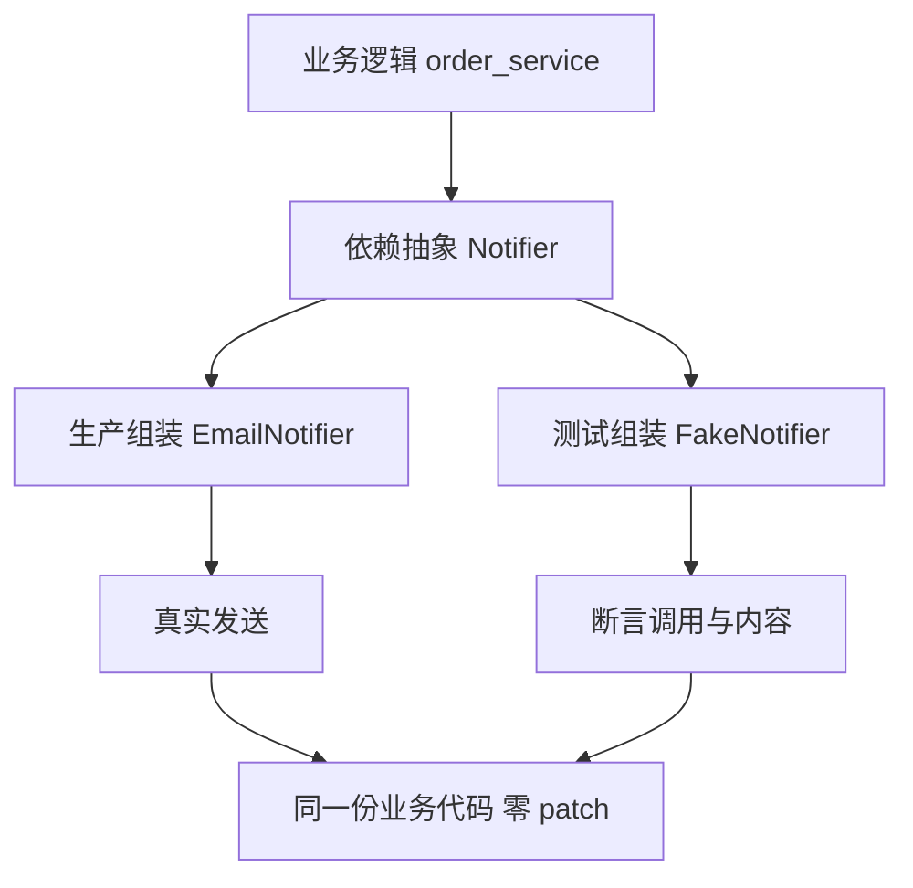

### Q228 · 依赖注入:让代码天生可测

> 难度:★★★ | 标签:依赖注入, 设计

**问**:为什么说"测试难写"往往是设计问题?依赖注入怎么落地到 Python?

**答**:测试难的代码通常**硬编码依赖**——函数内部直接 `import requests` 或自己 new 数据库客户端,想替换只能靠 patch 全局状态。**依赖注入(DI)** 把依赖作为参数从外部传入:业务函数只依赖抽象(Protocol/接口),测试传 Fake,生产传 Real,无需 patch。Python 落地方式从轻到重:构造参数注入 → pytest fixture 本身就是 DI 容器 → 框架级(dependency-injector、FastAPI 的 Depends)。判断标准:换掉一个依赖(如邮件服务商)需要改多少处代码、需要 patch 多少个名字。

```python
# file: code/05_数据分析与工程化/q228_di.py
from typing import Protocol


class Notifier(Protocol):
    def send(self, to: str, msg: str) -> bool: ...


class EmailNotifier:
    def send(self, to: str, msg: str) -> bool:
        raise RuntimeError("生产实现")


class FakeNotifier:
    def __init__(self):
        self.sent: list[tuple[str, str]] = []

    def send(self, to: str, msg: str) -> bool:
        self.sent.append((to, msg))
        return True


def order_service(notifier: Notifier, user: str) -> bool:
    # 业务逻辑只依赖抽象,测试时注入 Fake
    return notifier.send(to=user, msg="order confirmed")


def test_with_fake():
    fake = FakeNotifier()
    assert order_service(fake, "alice")
    assert fake.sent == [("alice", "order confirmed")]
```

**追问**:
- Protocol 在 DI 里怎么用?——定义抽象接口 `class Mailer(Protocol)`,业务函数只认 Protocol;测试传 FakeMailer,类型检查也通过。
- FastAPI 的 Depends 是 DI 吗?——是,路由依赖由框架解析注入,测试用 dependency_overrides 替换;它是请求作用域的轻量容器。
- DI 过度的信号?——只有一个实现且无测试需求也强抽象;先直写,出现「想换实现/想测试」再抽象,避免空中楼阁。


