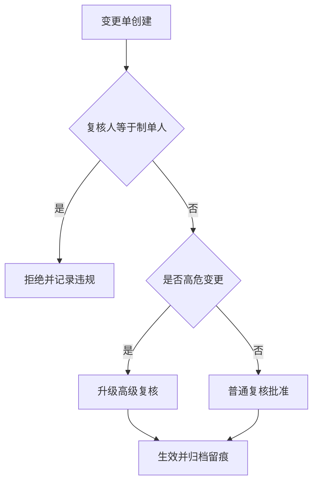

### Q2280 · 配置变更的双人复核:制单复核分离与升级

> 难度:★★★☆ | 标签:变更管理, 双人复核

**问**:配置改错一行能搞挂整个数据链路,"双人复核"怎么落地而不是走形式?

**答**:双人规则的核心是制单人与复核人分离,引擎做三道检查:同一人被拒绝——实测 alice 给自己批 CHG-1 被直接拒绝并记录违规;无复核人挂起等待认领,超时自动升级找下一级,不许"挂到过期";高危变更按内容分级,实测切换数仓大版本这类高危动作要求高级复核人,普通复核批不动要升级。通过后变更生效并归档,归档记录带制单人、复核人、时间与变更内容,审计时"谁批准的"永远可查。三个配套:复核界面要展示 diff 与影响面清单,复核人不是点同意按钮而是审内容;紧急变更走快速通道但事后 24 小时内补正式复盘;复核超时升级链与告警升级共用一套机制。

```python
# file: code/05_数据分析与工程化/q2280_two_person_rule.py
"""配置变更的双人复核: 制单复核分离与高危升级"""

from collections import namedtuple

Change = namedtuple("Change", "id maker checker action")


def review(change, is_senior=False):
    if change.checker == change.maker:
        return "拒绝", "制单人与复核人相同, 双人规则被破坏, 记录违规"
    if change.checker is None:
        return "挂起", "等待独立复核人认领, 超时自动升级"
    if "大版本" in change.action and not is_senior:
        return "升级", "高危变更需高级复核人批准"
    return "通过", f"复核人 {change.checker} 批准并归档"


if __name__ == "__main__":
    cases = [
        Change("CHG-1", "alice", "alice", "下调连接池到 5"),
        Change("CHG-2", "alice", None, "调整分区保留 30 天"),
        Change("CHG-3", "alice", "bob", "切换数仓大版本"),
    ]
    for c in cases:
        state, why = review(c)
        print(f"{c.id} [{c.action}] 制单 {c.maker} 复核 {c.checker} -> {state}: {why}")
    state, why = review(cases[2], is_senior=True)
    print(f"CHG-3 高级复核 -> {state}: {why}")
    print("要点: 制单复核分离; 高危变更按内容分级要求更高权限; 超时升级不许挂到过期; 归档可审计")
```

**追问**:
- 追问 1:小团队只有两个人怎么双人复核?—— 最低要求是时间分离,自批改为延迟生效加变更后自动校验,同时把高危动作收敛到配置模板减少手工修改。
- 追问 2:复核人怎么知道该看什么?—— 变更单强制附 diff、影响面清单和回滚方式,复核清单按变更类型生成,不看裸 diff。


