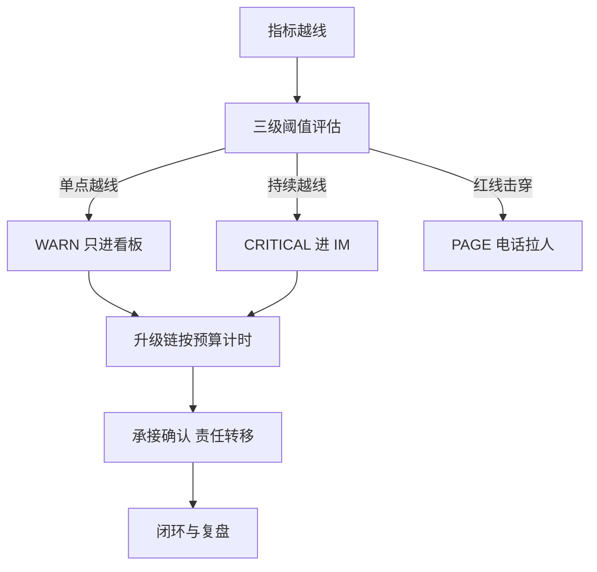

### Q2285 · 定时任务错峰:泳道排布压平峰值

> 难度:★★★☆ | 标签:调度, 容量

**问**:几十个定时任务都配在整点,凌晨机器飙满互相拖慢,怎么排?

**答**:错峰的本质是给任务做容量感知的排程:按允许的峰值并发划泳道,任务依次放进当前负载最小的泳道,泳道内顺序排,整点扎堆变成均匀铺开。实测 7 个任务按 3 条泳道排布:泳道 0 装下三个重任务串行 75 分钟,泳道 1、2 装轻任务,总工期 75 分钟且任意时刻最多 3 个任务并行,机器峰值被泳道数硬性压平。三条纪律:任务声明预期时长进配置,排程用声明值、监控用实测值,偏差大就更新声明;有依赖关系的任务先满足依赖再错峰,错峰不能破坏 DAG;排程结果随任务增减自动重算,窗口超限时告警提示扩容或减任务,而不是默默排队溢出到白天。整点扎堆是自造故障里最常见的一种,错峰排程是成本最低的治理。

```python
# file: code/05_数据分析与工程化/q2285_job_stagger.py
"""定时任务错峰: 泳道排布压平峰值"""

from collections import namedtuple

Job = namedtuple("Job", "name dur_min lane")
JOBS = [
    Job("dwd_a", 25, 0), Job("dwd_b", 20, 0), Job("dwd_c", 30, 0),
    Job("dws_a", 15, 1), Job("dws_b", 10, 1),
    Job("export_mail", 8, 2), Job("cleanup", 12, 2),
]
WINDOW = 90   # 凌晨维护窗口分钟数


def stagger(jobs):
    """任务进当前负载最小的泳道, 泳道内顺序排"""
    lanes, load = {}, {}
    for j in jobs:
        start = load.get(j.lane, 0)
        end = start + j.dur_min
        lanes.setdefault(j.lane, []).append((start, end, j.name))
        load[j.lane] = end
    return lanes


if __name__ == "__main__":
    lanes = stagger(JOBS)
    peak = 0
    for lane in sorted(lanes):
        print(f"泳道 {lane}: " + "  ".join(f"{name}[{s}-{e}]" for s, e, name in lanes[lane]))
        peak = max(peak, max(e for _, e, _ in lanes[lane]))
    over = [l for l, items in lanes.items() if max(e for _, e, _ in items) > WINDOW]
    print(f"总工期 {peak} 分钟, 峰值并发 <= 泳道数 {len(lanes)}, 超窗泳道: {over if over else '无'}")
    print("要点: 整点扎堆是自造故障; 泳道数硬限峰值并发; 依赖先于错峰, 窗口超限要告警而不是默默溢出")
```

**追问**:
- 追问 1:泳道数怎么定?—— 按机器峰值容量反推,同时能跑几组重任务就开几条,留 20% 余量给临时任务。
- 追问 2:任务实际耗时经常超声明怎么办?—— 实测值滚动更新声明,连续超时任务单独治理;泳道间留缓冲位吸收抖动。


