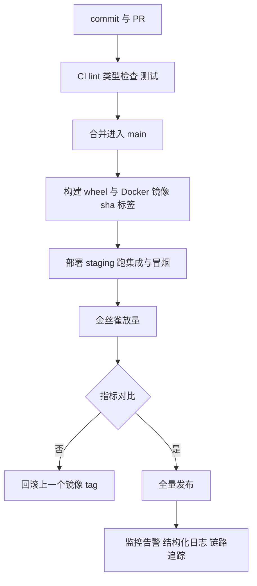

### Q230 · 发布流水线全景:从 commit 到生产

> 难度:★★★★ | 标签:CD, 发布流程

**问**:把整章串起来:一个 commit 到生产环境会经过哪些关卡?

**答**:一条完整 CD 流水线:1) **commit/PR 触发 CI**——lint、类型检查、单测、覆盖率门禁;2) **合并后构建产物**——打包 wheel、构建并推送带 git sha 标签的 Docker 镜像(镜像不可变,一个 sha 唯一对应一次构建);3) **部署到 staging**——自动跑集成测试与冒烟;4) **生产发布**——金丝雀放量 + 指标看板对比,达标逐步全量;5) **随时可回滚**——回滚 = 重新部署上一个镜像 tag,配合向后兼容的迁移(Q222)。支撑要素:不可变镜像、配置外部化(Q208)、结构化日志与 trace id(Q223/224)、灰度脚本(Q221)。面试时能把这条链路完整讲出来,并能指出每一环"失败怎么办",比罗列工具名更能体现工程能力。

```python
# file: code/05_数据分析与工程化/q230_pipeline.py
from dataclasses import dataclass


@dataclass
class Artifact:
    image: str
    sha: str


def pipeline(commit: str, gates: dict[str, bool]) -> list[str]:
    # 返回流水线实际走过的阶段
    stages = []
    if not all(gates.values()):
        stages.append("ci-failed")
        return stages
    stages += ["build-wheel", "build-image"]
    artifact = Artifact(image=f"reg/app:{commit[:7]}", sha=commit)
    stages.append(f"deploy-staging:{artifact.image}")
    if gates.get("smoke_ok"):
        stages += ["canary-5", "canary-50", "deploy-all"]
    return stages


def test_happy_path():
    gates = {"lint": True, "test": True, "smoke_ok": True}
    stages = pipeline("abcdef1234567890", gates)
    assert stages[-1] == "deploy-all"
    assert stages[0] == "build-wheel"

def test_ci_failure_short_circuits():
    assert pipeline("x" * 40, {"lint": False, "test": True}) == ["ci-failed"]
```

**追问**:
- 镜像 tag 为什么用 git sha?——一个 sha 唯一对应一次构建与代码版本;latest/分支名 tag 会被覆盖,回滚时找不到「上一个」。
- staging 测什么?——真实依赖的集成测试、迁移演练、冒烟;和生产同构才有意义,同构不了就 testcontainers 兜底。
- 发布与上线解耦是什么意思?——代码持续部署(灰度小流量),行为由 feature flag 控制;发布风险(部署失败)和业务风险(功能翻车)分开管理。


