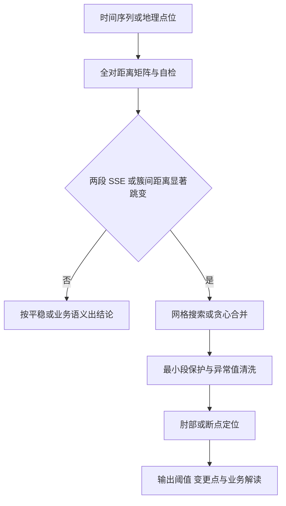

### Q2520 · 聚类停止阈值:合并距离的肘部

> 难度:★★★☆ | 标签:聚类, 肘部法则

**问**:上一题的 8 公里是拍脑袋的吧?阈值有没有数据依据?

**答**:有,用合并距离序列找肘部:把贪心合并每一步的簇间距离记录下来,簇内自然聚合时距离平稳(本例 1.4 到 2.0 公里),跨簇硬凑时距离跳涨(直接跳到 16.9 公里),最大跳变比达 8.3 倍,取跳变两侧的中点 9.5 公里做阈值,得到 4 个簇。肘部的含义是"合并成本突然变贵"的位置,那之后合并的都是不该在一起的点。相比拍一个 5 公里或 10 公里,肘部给了可复现、可解释的依据,还能写进口径字典随数据更新重算。注意肘部不明显时(跳变比小于 2)说明数据没有天然分组,此时应回到业务语义定阈值,而不是硬找肘部。轮廓系数是另一个候选指标,但计算量大且对单链接聚类不敏感,小规模场景肘部更直观。

```python
# file: code/05_数据分析与工程化/q2520_cluster_elbow.py
"""聚类停止阈值: 用合并距离序列的肘部替代拍脑袋"""

import math

SITES = [
    ("朝阳仓", 39.920, 116.470), ("通州仓", 39.910, 116.490),
    ("亦庄仓", 39.900, 116.480), ("海淀仓", 40.000, 116.300),
    ("昌平仓", 40.010, 116.310), ("大兴仓", 39.730, 116.340),
    ("房山仓", 39.720, 116.350), ("顺义仓", 40.130, 116.650),
]


def haversine_km(lat1, lon1, lat2, lon2):
    r = 6371.0
    p1, p2 = math.radians(lat1), math.radians(lat2)
    dp = math.radians(lat2 - lat1)
    dl = math.radians(lon2 - lon1)
    a = math.sin(dp / 2) ** 2 + math.cos(p1) * math.cos(p2) * math.sin(dl / 2) ** 2
    return 2 * r * math.asin(math.sqrt(a))


def merge_distances(points):
    """逐步合并最近的两个簇, 记录每次合并时的簇间最小距离"""
    d = [[haversine_km(p[1], p[2], q[1], q[2]) for q in points] for p in points]
    clusters = [[i] for i in range(len(points))]
    history = []
    while len(clusters) > 1:
        best = None
        for a in range(len(clusters)):
            for b in range(a + 1, len(clusters)):
                pair_min = min(d[i][j] for i in clusters[a] for j in clusters[b])
                if best is None or pair_min < best[0]:
                    best = (pair_min, a, b)
        history.append((best[0], len(clusters) - 1))
        _, a, b = best
        clusters[a].extend(clusters[b])
        del clusters[b]
    return history


def elbow_threshold(history):
    """取相邻合并距离比值最大的一跳之后作为阈值"""
    best_i, best_ratio = 1, 1.0
    for i in range(1, len(history)):
        prev = max(history[i - 1][0], 1e-9)
        ratio = history[i][0] / prev
        if ratio > best_ratio:
            best_i, best_ratio = i, ratio
    return (history[best_i - 1][0] + history[best_i][0]) / 2, best_ratio


if __name__ == "__main__":
    history = merge_distances(SITES)
    print("合并距离序列(距离, 合并后簇数):")
    for dist, k in history:
        print(f"  合并到 {k} 簇时距离 {dist:.1f}km")
    thr, ratio = elbow_threshold(history)
    print(f"肘部: 最大跳变 x{ratio:.1f}, 建议阈值取 {thr:.1f}km")
    assert ratio > 2, "本例应存在明显肘部"
    kept = sum(1 for dist, _ in history if dist <= thr)
    print(f"按该阈值停止合并, 得到 {kept} 个簇; 与按 5km 拍脑袋相比有数据依据")
    print("要点: 肘部找的是'合并成本突然变贵'的位置, 那之后合并的都是跨商圈硬凑")
```

**追问**:
- 肘部不明显时怎么办?——多组随机起点重复合并取平均合并距离序列,或换轮廓系数/Gap Statistic 交叉验证;单一序列的肘部有时真不清晰。
- 阈值取 9.5 还是取跳变点 16.9?——取跳变中点:低于 16.9 的簇内合并全部保留,高于则全部拒绝;取跳变点本身会把边界簇错误拆开。
- 肘部法的前提是什么?——合并是贪心且距离单调增长的;非凸簇或密度差异大的数据上肘部法会失真,要换 DBSCAN 类按密度定义簇的方法。



