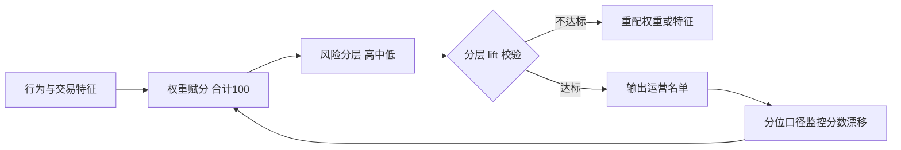

### Q2526 · 评分卡校验:分层 lift 与分数漂移

> 难度:★★★★ | 标签:评分卡, 分数漂移

**问**:评分卡上线后,怎么证明它还有效?

**答**:两个校验。一是分层 lift:按分数排序切十分位,逐组算实际流失率与基线之比,实测头部十分位 lift 2.86、单调递减到尾部队 0,曲线单调说明分数有区分力,曲线翻转说明权重该重配了。二是分数漂移:全员行为变化会让分数整体位移,实测次月所有用户分数统一抬升 25 分后,固定阈值 60 分的命中名单从 18 人膨胀到 29 人,运营容量瞬间被击穿;改用分位数口径——取分数最高 25% 做名单——两期都是 10 人,规模稳定。正确姿势是双轨:绝对分阈值解读业务含义(60 分以上值得外呼),相对分位生成行动名单,漂移监控盯分数分布的 PSI。分数是仪表盘不是刻在石头上的律法,分布变了校准就要跟。

```python
# file: code/05_数据分析与工程化/q2526_scorecard_lift.py
"""评分卡校验: 十分位 lift 曲线与分数漂移的口径修正"""

USERS = []
for i in range(40):
    USERS.append({"id": f"u{i:02d}", "score": 10 + (i * 37) % 90})
USERS.sort(key=lambda u: -u["score"])
for j, u in enumerate(USERS):          # 分数越高流失概率越高, 用排序位造标签
    u["churn"] = j < 14

RAW_THRESHOLD = 60
DRIFT_DELTA = 25                        # 次月全员行为变化, 分数整体抬升


def decile_lift(users, parts=10):
    n = len(users)
    size = n // parts
    base = sum(u["churn"] for u in users) / n
    lifts = []
    for d in range(parts):
        grp = users[d * size:(d + 1) * size]
        rate = sum(u["churn"] for u in grp) / size
        lifts.append(rate / base)
    return base, lifts


if __name__ == "__main__":
    base, lifts = decile_lift(USERS)
    print("十分位 lift(第1组=分数最高): " + ", ".join(f"D{i + 1} {l:.2f}" for i, l in enumerate(lifts)))
    assert lifts[0] > 2 * lifts[-1], "头部组 lift 应显著高于尾部组"
    print(f"整体流失率 {base:.0%}, 头部十分位 lift {lifts[0]:.2f}")
    month1 = [u["score"] for u in USERS]
    month2 = [min(s + DRIFT_DELTA, 100) for s in month1]
    raw1 = sum(1 for s in month1 if s >= RAW_THRESHOLD)
    raw2 = sum(1 for s in month2 if s >= RAW_THRESHOLD)
    print(f"固定阈值 {RAW_THRESHOLD} 分: 本月命中 {raw1} 人, 次月命中 {raw2} 人 -> 行为漂移导致误报膨胀")
    assert raw2 > raw1 * 1.5, "次月原始阈值命中数应显著膨胀"
    k = len(USERS) // 4
    print(f"改为分位数口径(取分数最高 25%): 本月 {k} 人, 次月 {k} 人 -> 名单规模稳定")
    assert k == 10
    print("要点: 阈值用绝对分解读业务含义, 拿名单看相对分位, 二者并行才扛得住分布漂移")
```

**追问**:
- 为什么固定阈值会被漂移击穿?——分数分布整体位移时,固定分数线两侧的人群数量剧变,运营容量是按人配的;分位数口径自动适配分布位移。
- lift 单调性怎么用?——头部组 lift 高且逐组递减说明排序有效;出现翻转(中段比头部高)说明某维权重把人群排反了,要回权重配置查。
- 怎么决定用哪个口径上线?——看下游消费方式:固定阈值便于解释和 SLA,分位数口径容量稳定;两者都要在监控里配漂移告警。



