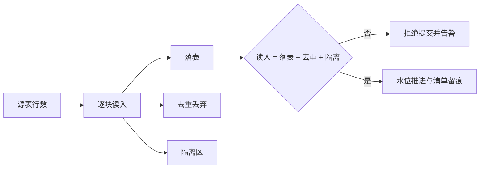

### Q2531 · 目标表行数守恒断言

> 难度:★★☆☆ | 标签:数据对账, 守恒

**问**:ETL 跑完了,你怎么保证没有静默丢数据?

**答**:上守恒断言:源表读入行数 = 落表 + 去重丢弃 + 隔离区,三笔支出都必须显式记账,差一行就拒绝提交。实测三块共 3000 行的正常批次守恒通过;把中间一块改成"读入 1000、落表 900、去重 0、隔离 1",断言当场爆炸并报出"差额 99",而不是等月底对账才发现少了 99 行说不出去向。守恒式的价值在于把"数据去哪了"变成强制回答:每一行输入必须在三个出口里选一个,不允许第四种消失方式。落地时逐块校验加总账双保险,块级失败能直接定位分片。配套的隔离区要有人管:隔离行数持续增长说明上游 schema 或质量在恶化,守恒通过不代表数据健康,只代表去向清楚。

```python
# file: code/05_数据分析与工程化/q2531_row_conservation.py
"""目标表行数守恒断言: 输入 = 落表 + 去重 + 隔离, 差一行都不行"""


class ConservationError(Exception):
    """行数守恒被破坏"""


def check_chunks(chunks):
    """chunks: 每块 (读入, 落表, 去重丢弃, 隔离区); 逐块与总账双重校验"""
    total_read = total_out = 0
    for i, (read, written, dup, reject) in enumerate(chunks):
        if read != written + dup + reject:
            raise ConservationError(
                f"第 {i} 块守恒失败: 读入 {read} != 落表 {written} + 去重 {dup} + 隔离 {reject}"
                f", 差额 {read - written - dup - reject}")
        total_read += read
        total_out += written + dup + reject
    return total_read, total_out


if __name__ == "__main__":
    good = [(1000, 950, 30, 20), (1000, 990, 5, 5), (1000, 995, 3, 2)]
    read, out = check_chunks(good)
    print(f"正常批次: 读入 {read}, 支出 {out}, 守恒通过")
    assert read == out == 3000
    broken = good[:]
    broken[1] = (1000, 900, 0, 1)          # 中途丢行, 去重与隔离都没接住
    try:
        check_chunks(broken)
    except ConservationError as e:
        print("守恒断言拦截:", e)
    else:
        raise AssertionError("坏批次必须被拦截")
    print("要点: 守恒式把'数据去哪了'变成强制回答, 静默丢行在落地当场爆炸而不是月底对账才发现")
```

**追问**:
- 守恒断言放在哪个环节?——每批数据落表前的提交守卫里,断言失败拒绝提交;月底对账是事后追溯,守恒是事中拦截。
- 隔离区的行最终怎么处理?——进入人工/自动修复队列,修复后重新走一遍守恒计入;隔离不是终点,长期堆积分帐只会越积越多。
- 去重丢弃和业务上「合理重复」怎么区分?——去重键在口径文档里显式定义并告警丢弃率突增;丢弃率从 1% 跳到 10% 本身就是上游异常信号。



