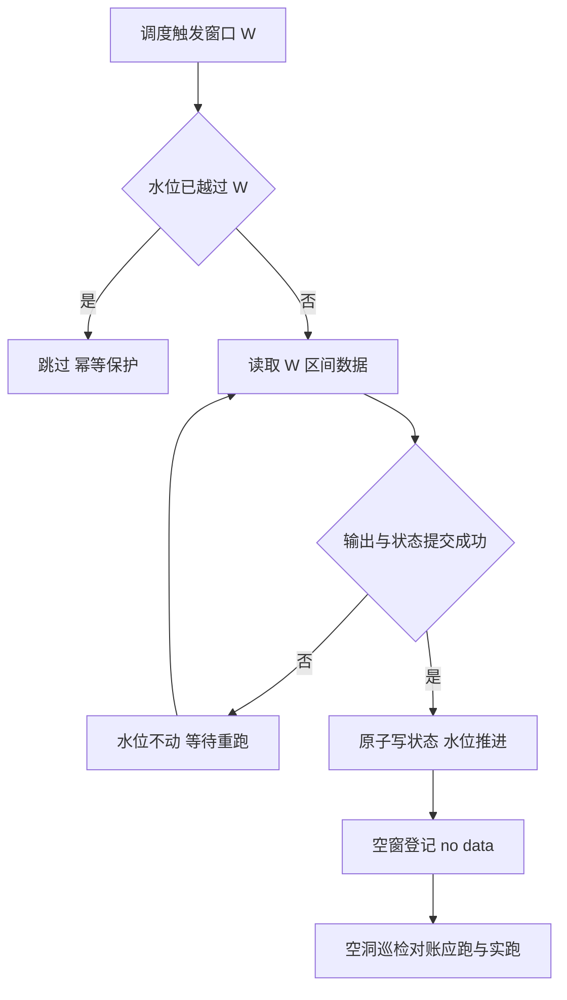

### Q2536 · 水位空洞检测:应跑窗口对账

> 难度:★★★★ | 标签:水位线, 空洞检测

**问**:调度显示所有任务"跑过了",为什么下游数还是缺一截?

**答**:因为调度只保证"触发过",不保证"连续覆盖"。10 点窗口失败后,如果 11 点窗口照常基于自己的水位跑,10 点那段数据就静默丢失,而所有任务都显示成功。检测方法是应跑与实跑对账:按调度计划枚举期望窗口序列(08 到 12 点共 5 个),与已处理窗口集合求差,实测检出空洞 10:00,同时检查孤儿窗口(计划外执行)与重复执行;回填重跑空洞后,5 个窗口全部连续,水位覆盖无缝。空洞检测应作为独立巡检任务挂在调度之外,每天对每个水位型管道核一次连续性。根因预防也重要:窗口任务必须只依赖水位而不依赖墙钟跳窗,失败窗口显式进重试队列,而不是被下一个窗口"顺理成章"地覆盖过去。

```python
# file: code/05_数据分析与工程化/q2536_watermark_gap.py
"""水位空洞检测: 应跑窗口与实跑窗口对账, 补上静默丢失的窗口"""

STEP = 60
EXPECTED = [h * 60 for h in range(8, 13)]          # 08:00..12:00 每小时一个窗口
PROCESSED = [480, 540, 660, 720]                   # 08 09 11 12 点的窗口, 10 点那次失败后没人补


def fmt(minute):
    return f"{minute // 60:02d}:{minute % 60:02d}"


def find_gaps(expected, processed):
    processed_set = set(processed)
    holes = [w for w in expected if w not in processed_set]
    orphans = sorted(processed_set - set(expected))
    dup = len(processed) - len(processed_set)
    return holes, orphans, dup


if __name__ == "__main__":
    holes, orphans, dup = find_gaps(EXPECTED, PROCESSED)
    print(f"应跑 {len(EXPECTED)} 个窗口, 实跑 {len(set(PROCESSED))} 个")
    print("空洞(静默丢数): " + (", ".join(fmt(h) for h in holes) or "无"))
    assert [fmt(h) for h in holes] == ["10:00"], "10 点窗口应被检出"
    print(f"孤儿窗口(计划外): {orphans or '无'}, 重复执行 {dup} 次")
    fixed = sorted(set(PROCESSED) | set(holes))       # 空洞回填重跑
    holes2, _, _ = find_gaps(EXPECTED, fixed)
    assert not holes2, "回填后不应再有空洞"
    print(f"回填重跑后: {len(fixed)} 个窗口全部连续, 水位覆盖无缝")
    print("要点: 调度只保证'触发过', 空洞检测保证'连续覆盖', 失败窗口必须显式回填而不是跳过")
```

**追问**:
- 空洞检测为什么不能靠任务自身补?——任务只知道自己那次跑没跑,不知道「计划里还应有哪些窗口」;必须有一个独立于任务的计划视图做对账。
- 回填时怎么保证幂等?——按窗口键 upsert 或先清后写该窗口分区;回填和正常写入走同一套幂等逻辑才不会双倍。
- 孤儿窗口和重复执行分别说明什么?——孤儿是计划外执行(手工触发/配置漂移),重复是同一窗口跑了两次;前者查变更记录,后者查调度去重。



