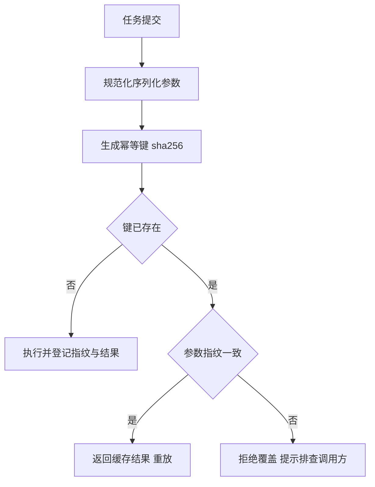

### Q2546 · 幂等键冲突:同键不同参拒绝

> 难度:★★★☆ | 标签:幂等, 冲突处理

**问**:同一个幂等键来了两次,但参数不一样,怎么办?

**答**:这是幂等设计里最关键的裁决:同键同参重放返回缓存结果(实测第二次返回 replay 且结果一致);同键不同参必须硬拒绝,因为覆盖会把两份语义不同的结果搅在同一键下,下游再也分不清哪份是真的。实测用 fp-2026-03-02 的指纹去撞已占用键,立即抛 IdempotencyConflict 并提示排查调用方 bug;冲突被拒后,原指纹重放仍然返回原结果,缓存未被污染。拒绝不是刁难,同键不同参只可能是三种错:调用方把键算错了、参数真变了却没换键、或有人在重放旧请求夹带新参数,三种都需要人来查而不是系统猜。存储结构是键到"指纹+结果"的映射,指纹同样用规范化参数哈希生成,与幂等键同源,保证比对口径一致。

```python
# file: code/05_数据分析与工程化/q2546_key_conflict_reject.py
"""幂等键冲突: 同键同参重放, 同键不同参必须拒绝"""


class IdempotencyConflict(Exception):
    """同一个幂等键被用来提交不同的参数"""


class IdempotencyStore:
    def __init__(self):
        self._store = {}      # key -> (fingerprint, result)

    def execute(self, key, fingerprint, result):
        if key in self._store:
            old_fp, old_result = self._store[key]
            if old_fp != fingerprint:
                raise IdempotencyConflict(
                    f"键 {key[:12]} 已被其他参数占用, 拒绝覆盖, 请先排查调用方 bug")
            return "replay", old_result
        self._store[key] = (fingerprint, result)
        return "new", result


if __name__ == "__main__":
    store = IdempotencyStore()
    status, value = store.execute("key-abc", "fp-2026-03-01", "结果A")
    print(f"首次提交: {status} -> {value}")
    status, value = store.execute("key-abc", "fp-2026-03-01", "结果A")
    print(f"同键同参重试: {status} -> {value} (不重复执行)")
    assert status == "replay"
    try:
        store.execute("key-abc", "fp-2026-03-02", "结果B")
    except IdempotencyConflict as e:
        print("同键不同参:", e)
    else:
        raise AssertionError("同键不同参必须拒绝")
    status, value = store.execute("key-abc", "fp-2026-03-01", "结果A")
    assert status == "replay" and value == "结果A", "冲突被拒后原结果不受污染"
    print("冲突被拒后原键仍可安全重放, 结果未被污染")
    print("要点: 幂等键是承诺不是缓存, 同键不同参说明调用方有 bug, 覆盖会把两份数据搅在一起")
```

**追问**:
- 追问 1:参数真的要变、任务要重算,合法路径是什么?—— 显式换键:参数进键,新参数自然新键;或走版本化重算,旧键结果归档不删。
- 追问 2:结果很大不适合缓存怎么办?—— 键登记指向产物指针(路径+指纹)而不是内联结果,重放校验指针所指产物的指纹仍在即可。


