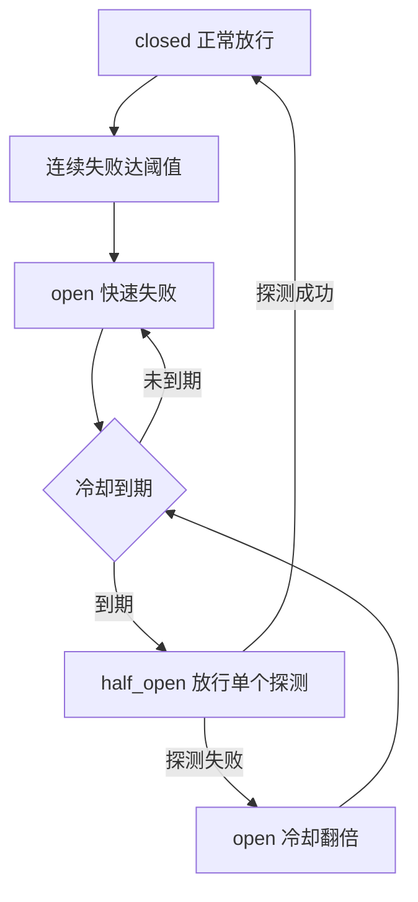

### Q2552 · 熔断恢复:半开探测与退避

> 难度:★★★★ | 标签:熔断, 半开

**问**:熔断打开后,服务恢复了你怎么知道?总不能一直手动重启吧?

**答**:状态机三态:closed、open、half_open。open 状态过冷却期后进入 half_open,只放行一个探测请求:探测成功则闭合、计数清零、冷却复位;探测失败则重新打开且冷却翻倍。实测时间线:t=0 连续失败 3 次进入 open 冷却 30 秒;t=29 仍拒绝;t=31 放行探测,成功后回到 closed;再次失败 3 次进 open,t=71 放行探测但失败,冷却翻倍到 60 秒。半开期只放一个探测是关键细节:放一群探测等于让重试洪峰把刚喘过气的依赖再次打死,这正是很多自研熔断恢复即雪崩的原因。冷却翻倍是指数退避思想用在了恢复侧,反复探测失败说明依赖没好,别每小时去戳一次。时钟必须注入,否则恢复逻辑的测试要靠真实 sleep,单测跑不动。

```python
# file: code/05_数据分析与工程化/q2552_breaker_halfopen.py
"""熔断恢复: 半开探测成功才闭合, 失败退避翻倍"""

BASE_COOLDOWN = 30
FAIL_LIMIT = 3


class Breaker:
    def __init__(self, clock):
        self.clock = clock
        self.state = "closed"
        self.fails = 0
        self.cooldown = BASE_COOLDOWN
        self.opened_at = None

    def can_pass(self):
        if self.state == "closed":
            return True
        if self.state == "open" and self.clock() - self.opened_at >= self.cooldown:
            self.state = "half_open"      # 只放一个探测请求
            return True
        return False

    def on_result(self, ok):
        if ok:
            self.state, self.fails, self.cooldown = "closed", 0, BASE_COOLDOWN
        else:
            self.fails += 1
            if self.state == "half_open":
                self.cooldown *= 2        # 探测失败, 退避翻倍
            if self.fails >= FAIL_LIMIT or self.state == "half_open":
                self.state, self.opened_at = "open", self.clock()


now = [0]


def clock():
    return now[0]


def fail_n(bk, n):
    for _ in range(n):
        bk.on_result(False)


if __name__ == "__main__":
    bk = Breaker(clock)
    fail_n(bk, FAIL_LIMIT)
    print(f"t={now[0]} 连续失败 3 次 -> {bk.state}, 冷却 {bk.cooldown}s")
    now[0] = 29
    assert not bk.can_pass()
    now[0] = 31
    assert bk.state == "open" and bk.can_pass()
    print(f"t=31 冷却结束放行探测 -> {bk.state}")
    bk.on_result(True)
    print(f"探测成功 -> {bk.state}, 计数清零冷却复位 {bk.cooldown}s")
    fail_n(bk, FAIL_LIMIT)
    now[0] = 71
    assert bk.can_pass() and bk.state == "half_open"
    bk.on_result(False)
    print(f"t=71 探测失败 -> {bk.state}, 冷却翻倍到 {bk.cooldown}s")
    assert bk.cooldown == 60 and bk.state == "open"
    print("要点: 半开期只放一个探测, 成功闭合 失败退避翻倍, 避免恢复瞬间被重试洪峰再次打死")
```

**追问**:
- 为什么探测只放一个请求?——半开期下游可能未恢复,全量放行等于二次冲击;单探测成功才逐步放量。
- 冷却翻倍的依据?——指数退避思想:连续探测失败说明故障未愈,避免固定间隔反复冲击;通常配冷却上限封顶。
- 熔断期间调用方怎么办?——直接走降级路径(缓存/默认值),并把熔断状态暴露为指标;熔断不感知就是白熔断。



