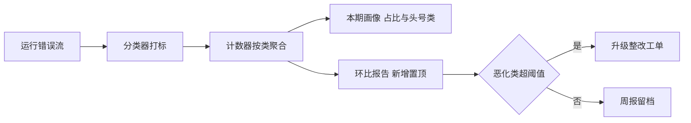

### Q2557 · 错误统计的跨期对比报告

> 难度:★★★☆ | 标签:错误统计, 环比

**问**:单期画像有了,怎么证明这周的治理动作有效?

**答**:上环比:上期与本期的分类计数逐类对比,输出差值、环比百分比和状态标签。实测上期 17 条到本期 18 条:data 类 10 降到 4(-60%)标改善,是本周修字段校验的成效;upstream 5 升到 9(+80%)标恶化,要追上游;code 类上期没有、本期 3 条,标新增且置顶——新类别出现永远最值得看,可能是新功能带病上线。排序规则:新增类置顶,其余按差值降序,恶化在前改善在后,行动项一目了然。合计也要给:总量 17 到 18 差 +1,防止单类占比误导。环比报告和画像互补:画像回答"现在的病是什么",环比回答"药有没有效",两者贴在同一份周报里,治理闭环才成立。基数为零的类别无法算环比,显式标"无法计算"而不是除零或硬给个百分比。

```python
# file: code/05_数据分析与工程化/q2557_error_trend_report.py
"""错误统计的跨期对比: 环比差值 新增类别与治理成效"""

PREV = {"upstream": 5, "data": 10, "infra": 2}
CURR = {"upstream": 9, "data": 4, "infra": 2, "code": 3}


def trend_report(prev, curr):
    lines, total_delta = [], 0
    cats = sorted(set(prev) | set(curr),
                  key=lambda c: (0 if prev.get(c, 0) == 0 else 1,
                                 -(curr.get(c, 0) - prev.get(c, 0))))
    for cat in cats:
        p, c = prev.get(cat, 0), curr.get(cat, 0)
        delta = c - p
        total_delta += delta
        if p == 0:
            tag, pct = "[新增]", "无法计算环比"
        else:
            pct = f"{delta / p:+.0%}"
            tag = "[恶化]" if delta > 0 else ("[改善]" if delta < 0 else "[持平]")
        lines.append(f"  {cat:<9} {p:3d} -> {c:3d}  差 {delta:+3d}  {pct:<8} {tag}")
    lines.append(f"  合计      {sum(prev.values()):3d} -> {sum(curr.values()):3d}  差 {total_delta:+3d}")
    return lines


if __name__ == "__main__":
    lines = trend_report(PREV, CURR)
    print("错误分类环比报告(上期 -> 本期):")
    print("\n".join(lines))
    assert "code" in lines[0] and "[新增]" in lines[0], "code 类应标记为新增且排最前"
    up_line = next(l for l in lines if l.strip().startswith("upstream"))
    data_line = next(l for l in lines if l.strip().startswith("data"))
    assert "[恶化]" in up_line and "[改善]" in data_line
    print("要点: 环比比绝对量更能驱动行动, 新增类别永远置顶, 改善类别要写进周报给团队正反馈")
```

**追问**:
- 为什么新增类别要置顶?——新错误类别意味着新故障源(新功能/新依赖),比存量类别的涨跌优先级高;置顶是给值班人的行动排序。
- 环比基线怎么选?——与上一周期比看短期变化,与上周同期比消除周内效应;日报用昨日环比+上周同期双基线。
- 分类体系本身怎么演进?——固定顶层枚举 + 受控的细分维护;分类随意增加会让跨期对比失去可比性。



