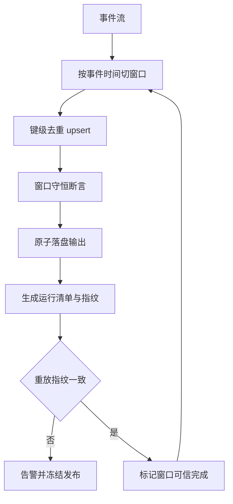

### Q2560 · 综合案例:批窗口守恒与可复现全链路

> 难度:★★★★★ | 标签:综合案例, 管道设计

**问**:把本卷的能力拼起来:一个可信的批处理窗口,最少要过几道关?

**答**:五道断言一条链。第一道窗口切片:按事件时间把事件流切进 [0,60)、[60,120)、[120,180) 三个窗口;第二道幂等去重:键级 upsert,窗口内重复的 (u1,30,pv) 只落表一次;第三道窗口守恒:读入 = 新落表 + 重复,实测窗口 1 读 4 行 = 新 3 + 重 1;第四道跨窗总账:三窗合计读入 7 行等于全部事件 7 行,无一行失踪;第五道清单指纹:每次运行落版本、参数、逐窗输入输出 SHA256,重放时落盘内容指纹与清单一致。五道关对应本卷五条主线——水位切片、幂等键、守恒断言、原子落盘、运行清单,任何一道缺失都有对应事故:少第一道丢数据,少第二道重计数,少第三四道静默失踪,少第五道历史说不清。可信的管道不是跑得通,是每一步都能自证。

```python
# file: code/05_数据分析与工程化/q2560_capstone_window.py
"""综合案例: 批窗口守恒与可复现全链路, 一次跑通五道断言"""

import hashlib
import json
import os
import tempfile

PIPELINE_VERSION = "pipe-2.0.0"
WINDOW = 60
EVENTS = [
    ("u1", 5, "click"), ("u2", 12, "pv"), ("u1", 30, "pv"),
    ("u1", 30, "pv"),                          # 窗口内重复事件
    ("u3", 70, "order"), ("u2", 95, "click"), ("u4", 130, "pv"),
]


def sha256(text):
    return hashlib.sha256(text.encode("utf-8")).hexdigest()


def process_window(lo, sink):
    """一个窗口: 按事件时间切片, 键级去重落表, 窗口内守恒对账"""
    hi = lo + WINDOW
    picked = [e for e in EVENTS if lo <= e[1] < hi]
    before = len(sink)
    dup = 0
    for user, ts, action in picked:
        key = (user, ts, action)
        if key in sink:
            dup += 1
        else:
            sink[key] = True
    new = len(sink) - before
    assert len(picked) == new + dup, "窗口守恒: 读入 = 新落表 + 重复"
    return {"window": [lo, hi], "read": len(picked), "new": new, "dup": dup,
            "input_sha256": sha256(json.dumps(picked))}


if __name__ == "__main__":
    with tempfile.TemporaryDirectory() as tmp:
        sink = {}
        manifest = {"pipeline_version": PIPELINE_VERSION, "params": {"window": WINDOW}, "windows": []}
        for lo in range(0, 180, WINDOW):
            entry = process_window(lo, sink)
            content = json.dumps(sorted(map(list, sink.keys())))
            out_path = os.path.join(tmp, f"out_{lo:03d}.json")
            with open(out_path, "w", encoding="utf-8") as f:
                f.write(content)
            with open(out_path, encoding="utf-8") as f:
                entry["output_sha256"] = sha256(f.read())
            manifest["windows"].append(entry)
            print(f"窗口 [{entry['window'][0]:3d},{entry['window'][1]:3d}): 读 {entry['read']} 行"
                  f" = 新落表 {entry['new']} + 重复 {entry['dup']}, 累计 {len(sink)} 键")
        accounted = sum(w["read"] for w in manifest["windows"])
        assert accounted == len(EVENTS), "跨窗口总账守恒"
        print(f"总账: 窗口合计读入 {accounted} 行 == 全部事件 {len(EVENTS)} 行, 无一行失踪")
        with open(os.path.join(tmp, "out_120.json"), encoding="utf-8") as f:
            replay = sha256(f.read()) == manifest["windows"][-1]["output_sha256"]
        assert replay, "重放校验: 落盘内容指纹必须与清单一致"
        print("重放校验: 末窗落盘指纹与清单一致, 版本/参数/逐窗指纹四件套齐备")
        print(f"清单版本 {manifest['pipeline_version']}, 参数 {manifest['params']}")
    print("要点: 窗口守恒 跨窗总账 幂等去重 原子落盘 清单指纹, 五道断言组成一次可信的批处理")
```

**追问**:
- 五道断言的执行顺序为什么不能换?——切片在前去重在后、窗口守恒依赖前两步产物、跨窗总账依赖全部窗口、指纹最后封存;顺序是数据流决定的。
- 清单指纹包含什么?——代码版本、参数、输入校验和、输出行数与校验和;有了指纹任何一次历史运行都能复现与比对。
- 这条链路怎么推广?——凡是「多步批处理」都可套用:切片→去重→分窗守恒→总账→指纹;断言失败立即阻断下游,坏数据走不远。



