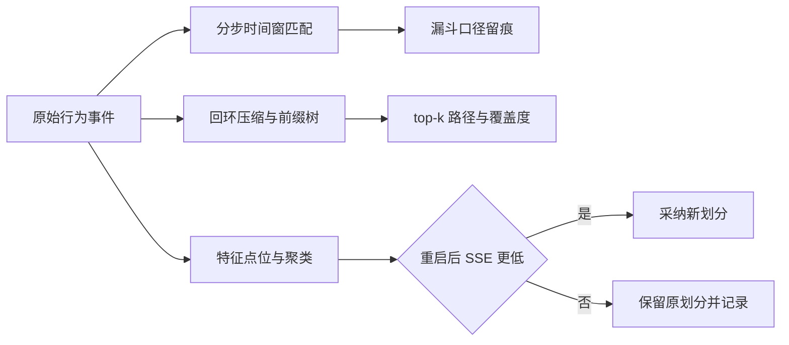

### Q2790 · 简单 k-means 实现:初始化与空簇处理

> 难度:★★★★ | 标签:聚类, k-means

**问**:面试官:不许调 sklearn,手写一个 k-means,你会注意哪些细节?

**答**:三个细节决定成败。初始化用 k-means++:第一个中心随机取,之后按"到已有中心最小距离的平方"加权抽,把起点拉开;迭代用 Lloyd 交替"分配-更新重心",分配不再变化即收敛,同时设最大迭代数兜底;空簇处理是把离自己质心最远的点挪过去补位,防止簇坍缩后聚出 k-1 个簇还谎报 k 个。实测 15 个点三个紧凑簇、k=3:k-means++ 起点质量高,1 轮就收敛,SSE 1.024,三簇各 5 个点,与真实划分完全一致。手写一遍的价值是理解参数:k 不是拍出来的,收敛也不保证全局最优——后者看下一题。

```python
# file: code/05_数据分析与工程化/q2790_kmeans_basic.py
"""简单 k-means 实现: k-means++ 初始化, 空簇处理与收敛判定"""
import random

POINTS = [
    (1.0, 1.0), (1.2, 0.8), (0.8, 1.2), (1.0, 1.4), (0.9, 0.9),
    (5.0, 5.0), (5.2, 4.8), (4.8, 5.2), (5.0, 5.4), (4.9, 5.1),
    (1.0, 5.0), (1.2, 4.8), (0.8, 5.2), (1.0, 5.4), (1.4, 5.0),
]
TRUE_LABEL = [0] * 5 + [1] * 5 + [2] * 5


def d2(a, b):
    return (a[0] - b[0]) ** 2 + (a[1] - b[1]) ** 2


def kmeans_pp_init(points, k, rng):
    """k-means++: 第一个随机取, 之后按距离平方加权取样"""
    centers = [points[rng.randrange(len(points))]]
    while len(centers) < k:
        weights = [min(d2(p, c) for c in centers) for p in points]
        total = sum(weights)
        if total == 0:
            centers.append(points[rng.randrange(len(points))])
            continue
        x, acc = rng.random() * total, 0.0
        for p, w in zip(points, weights):
            acc += w
            if acc >= x:
                centers.append(p)
                break
    return centers


def assign(points, centers):
    return [min(range(len(centers)), key=lambda j: d2(p, centers[j])) for p in points]


def lloyd(points, k, rng, max_iter=50):
    centers = kmeans_pp_init(points, k, rng)
    labels = assign(points, centers)
    for it in range(1, max_iter + 1):
        # 重心更新, 空簇用离自己质心最远的点补位
        for j in range(k):
            members = [p for p, l in zip(points, labels) if l == j]
            if members:
                centers[j] = (sum(p[0] for p in members) / len(members),
                              sum(p[1] for p in members) / len(members))
            else:
                far = max(range(len(points)), key=lambda i: d2(points[i], centers[labels[i]]))
                centers[j] = points[far]
                labels[far] = j
        new_labels = assign(points, centers)
        if new_labels == labels:
            return centers, labels, it
        labels = new_labels
    return centers, labels, max_iter


def inertia(points, centers, labels):
    return sum(d2(p, centers[l]) for p, l in zip(points, labels))


if __name__ == "__main__":
    rng = random.Random(42)
    centers, labels, iters = lloyd(POINTS, 3, rng)
    print(f"收敛迭代 {iters} 轮, 惯性 SSE {inertia(POINTS, centers, labels):.3f}")
    for j, c in enumerate(centers):
        size = sum(1 for l in labels if l == j)
        print(f"  簇 {j}: 中心 {c[0]:.2f},{c[1]:.2f}  成员 {size} 个")
    # 纯度检验: 每个真实簇应整体落入同一个预测簇
    purity_map = {}
    for t, p in zip(TRUE_LABEL, labels):
        purity_map.setdefault(t, set()).add(p)
    pure = all(len(v) == 1 and len(purity_map) == 3 for v in purity_map.values())
    print(f"三个真实簇的映射: {dict((k, sorted(v)) for k, v in purity_map.items())}")
    assert pure, "三个紧凑簇应被完全正确划分"
    sizes = sorted(sum(1 for l in labels if l == j) for j in range(3))
    assert sizes == [5, 5, 5], "每簇应恰有 5 个点"
    print("要点: k-means++ 决定起点质量, 空簇补位防止簇坍缩, 分配不再变化即收敛")
```

**追问**:
- 追问 1:为什么按距离平方加权采样?—— 远点成为新中心的概率更大,起点更分散,系统性降低坏初始化概率。
- 追问 2:空簇为什么危险?—— 说明某个中心没有数据支撑,实际聚出 k-1 个簇却仍按 k 个上报,下游分层与配额都会错位。


