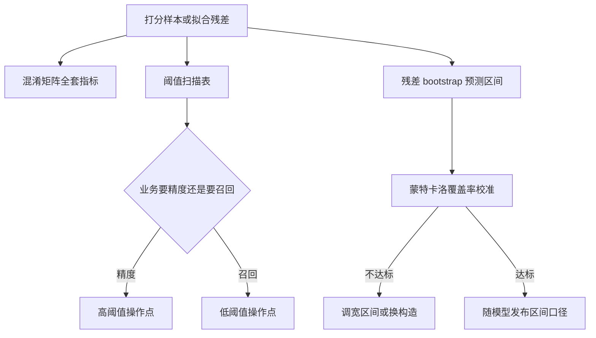

### Q2795 · 预测区间的覆盖率校准:蒙特卡洛验证

> 难度:★★★★★ | 标签:bootstrap, 覆盖率

**问**:面试官:你说区间是 90%,凭什么?验证过吗?

**答**:名义 90% 不等于真 90%,区间构造自己也要有"单测"。做法是蒙特卡洛:200 次实验,每次生成 30 个带高斯噪声的观测、拟合、残差 bootstrap 300 次构造 90% 区间,再用一条带噪声的新观测检验是否落进区间。实测覆盖率 84.0%(168/200),略低于名义值——残差 bootstrap 在小样本下区间略偏窄,是已知现象。处置有三条:加样本量、把分位数向外扩、或换 studentized 构造。关键不是 84% 这个数,而是把"我们说 90% 就是 90%"从口号变成可验证陈述:区间构造是代码,发布前跑覆盖率模拟,不达标就不许随模型上线。

```python
# file: code/05_数据分析与工程化/q2795_pi_coverage_sim.py
"""预测区间的覆盖率校准: 蒙特卡洛验证名义 90% 是不是真 90%"""
import random


def ols(xs, ys):
    n = len(xs)
    mx, my = sum(xs) / n, sum(ys) / n
    cov = sum((x - mx) * (y - my) for x, y in zip(xs, ys))
    var = sum((x - mx) ** 2 for x in xs)
    b = cov / var
    a = my - b * mx
    return a, b, [y - (a + b * x) for x, y in zip(xs, ys)]


def bootstrap_pi(xs, ys, x_new, level, boots, rng):
    a, b, resid = ols(xs, ys)
    lo_q = (1 - level) / 2 * 100
    preds = []
    for _ in range(boots):
        ys_b = [a + b * x + resid[rng.randrange(len(resid))] for x in xs]
        a_b, b_b, resid_b = ols(xs, ys_b)
        preds.append(a_b + b_b * x_new + resid_b[rng.randrange(len(resid_b))])
    preds.sort()
    return preds[int(len(preds) * lo_q / 100)], preds[int(len(preds) * (100 - lo_q) / 100)]


if __name__ == "__main__":
    n, sims, boots, level = 30, 200, 300, 0.90
    master = random.Random(2026)
    covered = 0
    for s in range(sims):
        xs = list(range(1, n + 1))
        rnd = random.Random(1000 + s)
        ys = [1.5 + 0.6 * x + rnd.gauss(0, 2.0) for x in xs]
        truth = 1.5 + 0.6 * 15  # 新观测真值在回归线附近再叠一份噪声
        new_y = truth + master.gauss(0, 2.0)
        lo, hi = bootstrap_pi(xs, ys, 15, level, boots, master)
        if lo <= new_y <= hi:
            covered += 1
    emp = covered / sims
    print(f"模拟 {sims} 次, 每次 {boots} 次重抽样, 名义覆盖率 {level:.0%}")
    print(f"实测覆盖率 {emp:.1%} (覆盖 {covered}/{sims})")
    assert 0.80 <= emp <= 0.98, "残差 bootstrap 的实测覆盖率应接近名义值"
    print("要点: 名义 90% 不等于真 90%, 用固定种子的蒙特卡洛校准区间构造, 是发布前的自证动作")
```

**追问**:
- 追问 1:为什么不直接用解析公式?—— 解析公式依赖正态与同方差假设,残差 bootstrap 对分布更宽松,但两者都必须做覆盖率验证。
- 追问 2:覆盖率模拟的成本怎么控制?—— 固定种子一次定型后进 CI 当回归用例,模型或区间代码改动时才全量重跑。


