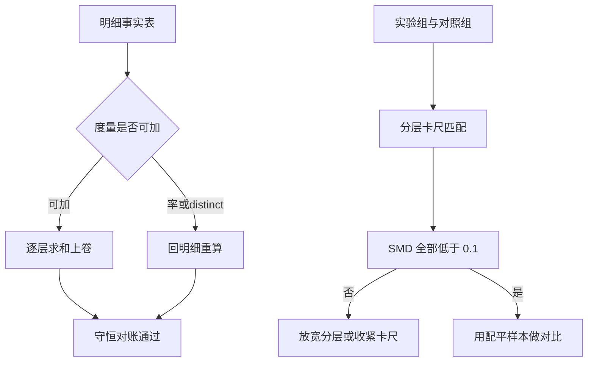

### Q2801 · 率值上卷的陷阱:重算而非平均

> 难度:★★☆☆ | 标签:率值, 上卷

**问**:面试官:三个城市的转化率分别是 5%、40%、4.5%,大盘转化率是多少?

**答**:不是 16.5%,是 5.58%。"把各层率求平均"是最常见的口径事故:三个城市大本营 A 5.0%(500/10000)、试点 B 40.0%(80/200)、自然量 C 4.5%(45/1000),平均法给出 16.50%,而正确做法是分子分母各求和再相除 625/11200=5.58%,平均法虚高 10.9 个百分点,方向被高转化小城市带偏。下钻归因同理:试点 B 率最高 40%,但订单占比只有 13%,小城市的高率对大盘贡献有限,不能因为率抢眼就 priority 排最前。纪律一句话:率是不可加度量,任何换粒度的动作,分子分母必须成对移动,各自求和后再相除。

```python
# file: code/05_数据分析与工程化/q2801_ratio_rollup.py
"""率值上卷的陷阱: 上卷必须用分子分母重算, 不能平均各层的率"""

CITIES = [
    # 城市, 访问数, 下单数
    ("大本营A", 10000, 500),
    ("试点B", 200, 80),
    ("自然量C", 1000, 45),
]


def rate(city):
    return city[2] / city[1]


if __name__ == "__main__":
    visits = sum(c[1] for c in CITIES)
    orders = sum(c[2] for c in CITIES)
    true_rate = orders / visits
    naive_rate = sum(rate(c) for c in CITIES) / len(CITIES)
    print("各城市转化率:")
    for name, v, o in CITIES:
        print(f"  {name}: {o}/{v} = {o / v:.1%}")
    print(f"错误做法(各层率求平均): {naive_rate:.2%}")
    print(f"正确做法(分子分母带回上卷重算): {orders}/{visits} = {true_rate:.2%}")
    print(f"虚高 {(naive_rate - true_rate):.1%} 个百分点, 方向被高转化的小城市带偏")
    assert naive_rate - true_rate > 0.08, "小城市高转化应把平均法显著带高"
    assert abs(true_rate - 625 / 11200) < 1e-9, "上卷结果应等于总分子除以总分母"
    # 率值在任意粒度都只能重算, 下钻同理
    top_city = max(CITIES, key=rate)
    print(f"下钻归因时也注意: 单看率最高的是 {top_city[0]} {rate(top_city):.0%}, "
          f"但它的订单占比仅 {top_city[2] / orders:.0%}")
    assert top_city[2] / orders < 0.15, "高率小城市的订单占比应很小"
    print("要点: 率是不可加度量, 每次换粒度都要分子分母各求和再相除, 平均各层率是最常见的口径事故")
```

**追问**:
- 追问 1:什么时候平均率反而是对的?—— 各层权重确实相等且业务目标就是"代表水平"时,但必须显式声明为"简单平均口径"。
- 追问 2:报表引擎里怎么防?—— 率值字段禁用 SUM 聚合,只暴露"分子列/分母列",聚合时动态相除。


