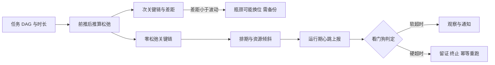

### Q2806 · 次关键链:扰动下的第二瓶颈与翻盘测试

> 难度:★★★★ | 标签:DAG, 次关键链

**问**:面试官:你们优化了关键路径,为什么总完工时间没怎么变?

**答**:因为瓶颈换位了。把上一题的 agg_shop 缩到 12 分钟后,关键链变成类目支线 95 分钟,商店支线 92 分钟——次关键链只差 3 分钟。做翻盘测试:把 agg_category 从 15 压到 11 分钟,压缩量超过 3 分钟差距,关键链立即翻转到商店支线 92 分钟。结论:当次关键链与关键链差距小于单任务的常规波动(十分钟级)时,任何只针对关键链的优化都可能白做。工程做法:排期报告列出全部根到叶链按时长降序的 top-3,次关键链与关键链差距小于阈值时,两条链的资源与监控同等级对待,优化前后都跑一遍翻盘测试确认瓶颈没搬家。

```python
# file: code/05_数据分析与工程化/q2806_near_critical_chain.py
"""次关键链: 扰动下的第二瓶颈与关键链翻盘测试"""

TASKS = {
    "pull_orders":  (20, []),
    "pull_pay":     (15, []),
    "clean_orders": (25, ["pull_orders"]),
    "clean_pay":    (10, ["pull_pay"]),
    "join_trade":   (20, ["clean_orders", "clean_pay"]),
    "agg_shop":     (12, ["join_trade"]),
    "agg_category": (15, ["join_trade"]),
    "load_report":  (10, ["agg_shop", "agg_category"]),
    "push_alert":   (5,  ["load_report"]),
}


def all_chains(tasks):
    """枚举起点到终点的全部任务链, 返回按总时长降序的列表"""
    deps_of = {t: v[1] for t, v in tasks.items()}
    succ = {t: [s for s in tasks if t in deps_of[s]] for t in tasks}
    roots = [t for t in tasks if not deps_of[t]]
    chains = []

    def dfs(node, path):
        kids = succ[node]
        if not kids:
            chains.append(list(path))
            return
        for k in kids:
            path.append(k)
            dfs(k, path)
            path.pop()

    for r in roots:
        dfs(r, [r])
    return sorted(chains, key=lambda c: -sum(tasks[t][0] for t in c))


def chain_len(chain):
    return sum(TASKS[t][0] for t in chain)


if __name__ == "__main__":
    chains = all_chains(TASKS)
    top = chains[0]
    second = chains[1]
    gap = chain_len(top) - chain_len(second)
    print("全部链路按时长降序 top3:")
    for c in chains[:3]:
        print(f"  {chain_len(c):>3} 分钟  {' -> '.join(c)}")
    print(f"关键链 {chain_len(top)} 分钟, 次关键链 {chain_len(second)} 分钟, 只差 {gap} 分钟")
    assert "agg_category" in top, "本例关键链应走类目聚合支线"
    assert "agg_shop" in second, "次关键链应是商店聚合支线"
    # 翻盘测试: 关键链上的独占任务缩短 4 分钟, 次关键链立即上位
    TASKS["agg_category"] = (11, ["join_trade"])
    chains2 = all_chains(TASKS)
    new_top = chains2[0]
    print(f"把 agg_category 从 15 压到 11 分钟后, 新关键链: {' -> '.join(new_top)} ({chain_len(new_top)} 分钟)")
    assert "agg_shop" in new_top, "压缩 4 分钟超过 3 分钟的差距, 关键链应翻转到商店支线"
    print("要点: 只盯着一条关键链的排期是脆的, 次关键链差距小于常规波动时, 瓶颈随时换位")
```

**追问**:
- 追问 1:链路枚举在密集 DAG 上会爆炸吗?—— 会,节点多时改用每次松弛一条边的 k 短路或对每条边做敏感性分析。
- 追问 2:翻盘测试放进流程的哪一步?—— 容量规划与排期评审各跑一次,优化方案必须附"优化后关键链归属"的证明。


