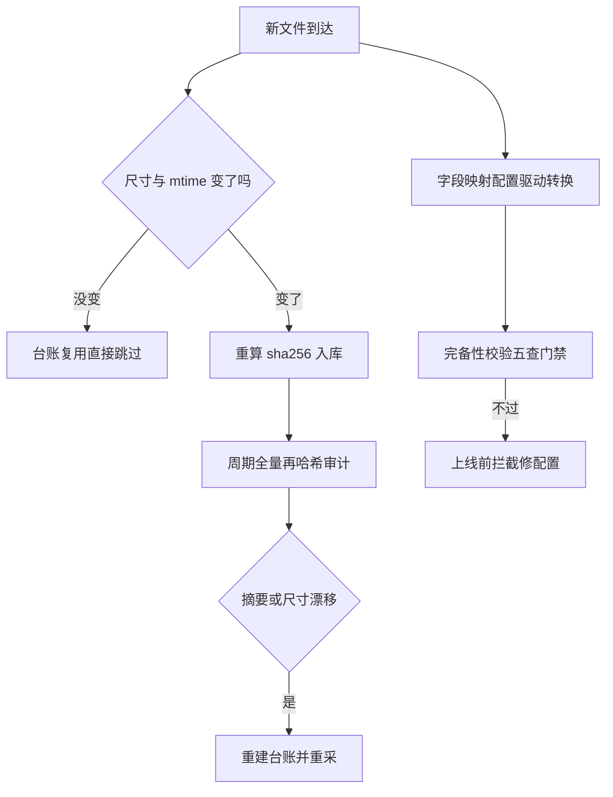

### Q2812 · 哈希台账的损坏审计:同尺寸改写与截断

> 难度:★★★☆ | 标签:哈希, 完整性审计

**问**:面试官:有台账就能保证数据没被动过吗?

**答**:不能,台账是增量跳过的依据,不是完整性证明,必须配周期性全量再哈希审计。模拟三种损坏:02 号文件同尺寸被改写(尺寸一致但摘要不同)、03 号被截断(台账 360B 磁盘 210B)、外加台账外文件。审计抓出 2 处:内容篡改与尺寸漂移;修复以磁盘现值重建台账,并把两个文件标记"重新采集"——台账修好不等于数据可用,内容变了必须重灌。结论:同尺寸改写只有再哈希能发现,这是审计不可替代的原因;审计频率按重要度分级,核心表每周、边缘月度,审计结果进质量报表。

```python
# file: code/05_数据分析与工程化/q2812_hash_audit_repair.py
"""哈希台账的损坏审计: 同尺寸改内容与截断文件都要抓出来"""
import hashlib

LEDGER = {
    # 文件名: 台账里的尺寸与摘要(采集入库时的状态)
    "events_2026-11-01.csv": {"size": 400, "sha256": "a" * 64},
    "events_2026-11-02.csv": {"size": 380, "sha256": "b" * 64},
    "events_2026-11-03.csv": {"size": 360, "sha256": "c" * 64},
}

DISK = {
    # 实际磁盘内容: 02 号同尺寸被改写, 03 号被截断, 01 号完好
    "events_2026-11-01.csv": {"size": 400, "sha256": "a" * 64},
    "events_2026-11-02.csv": {"size": 380, "sha256": "d" * 64},
    "events_2026-11-03.csv": {"size": 210, "sha256": "e" * 64},
}


def audit(ledger, disk):
    """全量再哈希审计, 返回问题清单"""
    findings = []
    for name in sorted(ledger):
        rec = ledger[name]
        cur = disk.get(name)
        if cur is None:
            findings.append((name, "丢失", "台账有档, 磁盘无文件"))
        elif cur["size"] != rec["size"]:
            findings.append((name, "尺寸漂移", f"台账 {rec['size']}B, 磁盘 {cur['size']}B"))
        elif cur["sha256"] != rec["sha256"]:
            findings.append((name, "内容篡改", "尺寸一致但摘要不同, 同尺寸改写"))
    for name in disk:
        if name not in ledger:
            findings.append((name, "台账外文件", "未登记, 需要补录或清理"))
    return findings


def repair(ledger, disk, findings):
    """修复: 尺寸漂移与篡改文件以磁盘现值为准重建台账并标记重采"""
    repaired, reingest = [], []
    for name, kind, _ in findings:
        if kind in ("尺寸漂移", "内容篡改") and name in disk:
            ledger[name] = dict(disk[name])
            repaired.append(name)
            reingest.append(name)
    return repaired, reingest


if __name__ == "__main__":
    findings = audit(LEDGER, DISK)
    print("审计发现:")
    for name, kind, detail in findings:
        print(f"  {name}  [{kind}]  {detail}")
    kinds = {kind for _, kind, _ in findings}
    assert "内容篡改" in kinds, "同尺寸改写必须靠摘要抓出来"
    assert "尺寸漂移" in kinds, "截断文件应表现为尺寸漂移"
    repaired, reingest = repair(LEDGER, DISK, findings)
    print(f"修复 {repaired}, 标记重新采集 {reingest}")
    assert sorted(reingest) == ["events_2026-11-02.csv", "events_2026-11-03.csv"]
    assert audit(LEDGER, DISK) == [], "修复后审计应零发现"
    print("要点: 台账不是免检金牌, 周期性全量再哈希是唯一能抓'同尺寸改内容'的手段; 修复必须连带重采")
```

**追问**:
- 追问 1:全量再哈希成本太高怎么办?—— 分块校验和加抽样审计分层,大文件按块摘要只重算可疑块,审计窗口错峰。
- 追问 2:发现篡改后第一动作是什么?—— 隔离当前文件保留证据,再决定重采还是从备份恢复,不要原地覆盖。


