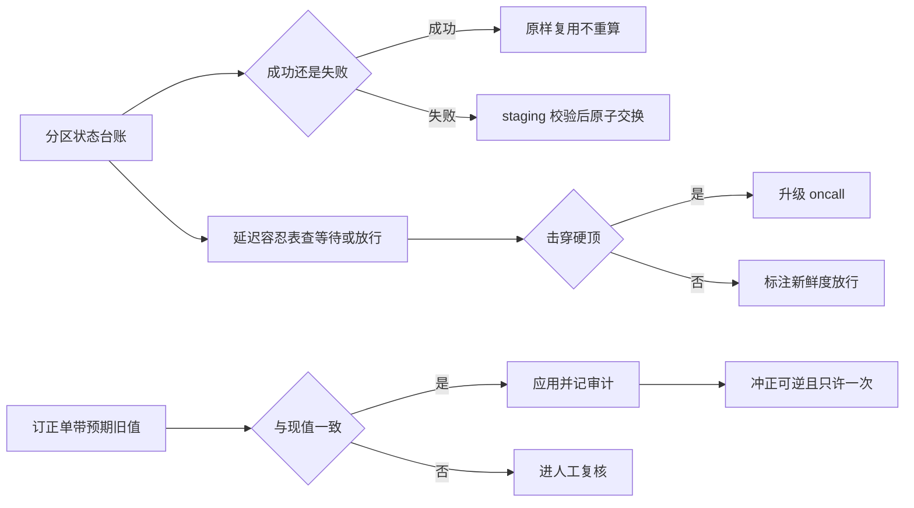

### Q2818 · 订正的冲正与幂等:同单号只生效一次

> 难度:★★★★ | 标签:订正, 冲正

**问**:面试官:订正改错了怎么退回来?能不能反复重放同一张订正单?

**答**:冲正可退,重放必挡。三条规则:同一单号幂等,重复提交直接拒绝;冲正把前镜像原路送回且只许一次;已冲正的单据不可重放,要改必须开新单。实测:C001 首次提交 amount 100→120;重复提交被拒("重复提交,幂等拒绝");冲正后回到 100;再次冲正被拒;用同一单号重放被拒,提示"已冲正,重放需开新订正单"。这三条保证出错永远有路可退(冲正),又不会因反复重放把数据翻来覆去(幂等),订正系统的安全性等同一个小型分布式事务。冲正前还要校验现值等于 new——不一致说明叠加了新订正,走人工合并而不是机器覆盖。

```python
# file: code/05_数据分析与工程化/q2818_correction_reversal.py
"""订正的冲正与幂等: 同单号只生效一次, 冲正把前镜像原路送回"""

DATASET = {"t1": {"amount": 100.0}}
LEDGER = {}   # corr_id -> {"old", "new", "reversed"}


def apply_correction(corr_id, key, field, old, new, dataset, ledger):
    if corr_id in ledger:
        rec = ledger[corr_id]
        if rec["reversed"]:
            return False, f"{corr_id} 已冲正, 重放需开新订正单"
        return False, f"{corr_id} 重复提交, 幂等拒绝"
    current = dataset[key][field]
    if current != old:
        return False, f"预期旧值 {old!r} 与现值 {current!r} 不符"
    dataset[key][field] = new
    ledger[corr_id] = {"old": old, "new": new, "reversed": False}
    return True, "applied"


def reverse_correction(corr_id, key, field, dataset, ledger):
    rec = ledger.get(corr_id)
    if rec is None:
        return False, f"{corr_id} 不存在"
    if rec["reversed"]:
        return False, f"{corr_id} 已冲正, 不可重复冲正"
    dataset[key][field] = rec["old"]
    rec["reversed"] = True
    return True, f"冲正完成, {field} 回到 {rec['old']!r}"


if __name__ == "__main__":
    results = []
    results.append(apply_correction("C001", "t1", "amount", 100.0, 120.0, DATASET, LEDGER))
    print(f"首次提交 C001: {results[-1][1]}, amount={DATASET['t1']['amount']}")
    results.append(apply_correction("C001", "t1", "amount", 100.0, 120.0, DATASET, LEDGER))
    print(f"重复提交 C001: {results[-1][1]}")
    assert results[-1][0] is False and "重复" in results[-1][1]
    ok, why = reverse_correction("C001", "t1", "amount", DATASET, LEDGER)
    print(f"冲正 C001: {why}, amount={DATASET['t1']['amount']}")
    assert ok and DATASET["t1"]["amount"] == 100.0
    ok2, why2 = reverse_correction("C001", "t1", "amount", DATASET, LEDGER)
    print(f"再次冲正 C001: {why2}")
    assert not ok2, "冲正不可重复执行"
    ok3, why3 = apply_correction("C001", "t1", "amount", 100.0, 120.0, DATASET, LEDGER)
    print(f"重放 C001: {why3}")
    assert not ok3 and "新订正单" in why3, "已冲正单据不可重放"
    assert DATASET["t1"]["amount"] == 100.0, "最终值应回到原始状态"
    print("要点: 单号幂等挡重放, 冲正送回前镜像且只许一次, 订正生命周期被台账锁死, 出错永远有路可退")
```

**追问**:
- 追问 1:冲正与新订正叠加冲突怎么办?—— 冲正前校验现值等于 new,不一致即叠加了新变更,冻结并走人工合并。
- 追问 2:订正台账要不要跟数据同库?—— 分库存储更安全,防止"改数据的人也能改台账",至少要做到 append-only 与权限分离。


