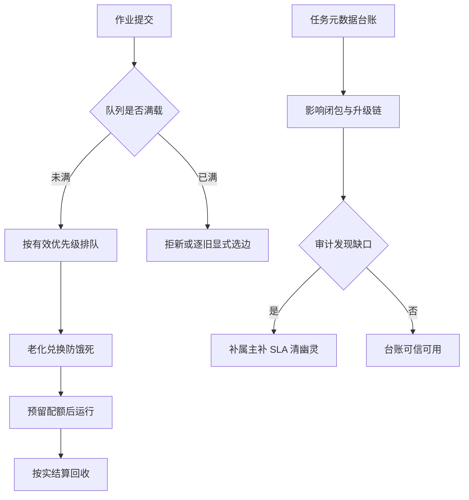

### Q2824 · 元数据完整性审计:台账自己的体检

> 难度:★★★☆ | 标签:元数据, 审计

**问**:面试官:台账本身缺了字段、挂了幽灵引用,谁来看住台账?

**答**:审计器。规则很便宜:必填字段存在性(owner、oncall、sla_hours)加外键存在性(downstream 引用的任务必须已登记)。实测四处埋的缺口全部被抓:ads_funnel 的下游 dm_unknown 未登记(影响面查询会断链,高危)、dwd_user 缺 owner(高危)、dws_user_day 缺 sla_hours(高危)、ods_sync_user 缺 oncall(中危);修补后审计归零。实践:每周自动扫一遍,结果进值班群;高危项冻结相关任务的变更权限,限期修补,让缺口有代价。元数据腐化是渐进的——今天少一个 owner,下个月事故时就找不到人,审计成本远低于一次"找不到属主"的事故。

```python
# file: code/05_数据分析与工程化/q2824_metadata_audit.py
"""元数据完整性审计: 台账自身的缺口也要有人查"""

REGISTRY = {
    "ods_sync_user":  {"owner": "team-infra", "sla_hours": 2,
                       "downstream": ["dwd_user"]},                       # 缺 oncall
    "dwd_user":       {"oncall": "bob", "sla_hours": 4,
                       "downstream": ["dws_user_day"]},                   # 缺 owner
    "dws_user_day":   {"owner": "team-warehouse", "oncall": "bob",
                       "downstream": ["ads_funnel"]},                     # 缺 sla_hours
    "ads_funnel":     {"owner": "team-bi", "oncall": "carol", "sla_hours": 6,
                       "downstream": ["dm_unknown"]},                     # 下游是幽灵任务
    "ads_cohort":     {"owner": "team-bi", "oncall": "carol", "sla_hours": 6,
                       "downstream": []},
}

REQUIRED_FIELDS = ["owner", "oncall", "sla_hours"]


def audit(registry):
    findings = []
    for task, meta in sorted(registry.items()):
        for field in REQUIRED_FIELDS:
            if field not in meta:
                sev = "high" if field in ("owner", "sla_hours") else "medium"
                findings.append((task, f"缺少 {field}", sev))
        for down in meta.get("downstream", []):
            if down not in registry:
                findings.append((task, f"下游 {down} 未登记, 影响面查询会断链", "high"))
    return findings


if __name__ == "__main__":
    findings = audit(REGISTRY)
    print("审计发现:")
    for task, issue, sev in findings:
        print(f"  [{sev:<6}] {task}: {issue}")
    assert len(findings) == 4, "四处埋的缺口都应被发现"
    assert any("oncall" in i and t == "ods_sync_user" for t, i, _ in findings)
    assert any("dm_unknown" in i for t, i, _ in findings), "幽灵下游必须暴露"
    sevs = {s for _, _, s in findings}
    assert "high" in sevs, "缺属主或幽灵下游都应为高危"
    # 干净台账应零发现
    clean = {t: dict(m, **{k: "x" for k in REQUIRED_FIELDS if k not in m})
             for t, m in REGISTRY.items()}
    for t, m in clean.items():
        m["downstream"] = [d for d in m["downstream"] if d in clean]
    assert audit(clean) == [], "修补后台账应零发现"
    print("要点: 台账是事故时唯一敢信的地图, 自己必须被审计; 缺属主 幽灵下游都是高危, 每周自动扫一次")
```

**追问**:
- 追问 1:审计发现幽灵下游,删还是补?—— 先人工确认是漏登记还是引用过期:漏登记补台账,过期引用删边并记录。
- 追问 2:审计怎么进流程?—— 作为 CI 检查跑在任务注册/变更 PR 上,新增缺字段的任务直接拦下。


