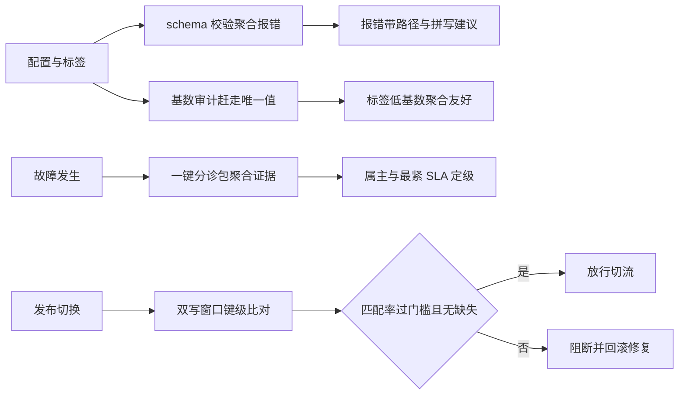

### Q2830 · 发布数据比对器:双写窗口的键级对账

> 难度:★★★★ | 标签:发布比对, 数据对账

**问**:面试官:重写了核心结算逻辑,怎么证明新代码的输出和旧代码等价才敢切流?

**答**:双写窗口加键级对账。新旧逻辑同时写,比对器按主键配对,字段级容差白名单(amount 容差 0.01,status 精确相等),门槛"无缺失且匹配率不低于 98%"。实测 100 个键:97 匹配、2 处值差异(键 12 金额 94.5 对 154.5、键 33 状态 ok 对 blocked)、1 处缺失(键 99),匹配率 97% 判 FAIL,禁止切流;修复三处后重比 100% PASS。与"发布前后指标快照对比"不同,键级对账精确指出哪个键哪个字段差多少,修复有明确靶子;容差白名单吸收小数舍入类假差异,不刷屏。注意键 7 的金额只差 0.001,在容差内算匹配——差异分级是比对器可信的前提。

```python
# file: code/05_数据分析与工程化/q2830_release_comparator.py
"""发布数据比对器: 双写窗口内新旧逻辑的键级抽样对账"""

TOLERANCE = {"amount": 0.01}
MATCH_RATE_GATE = 0.98


def gen_outputs():
    old, new = {}, {}
    for k in range(100):
        amount = round(50 + (k * 37) % 200 + (k % 7) * 0.1, 2)
        status = "ok" if k % 9 else "review"
        old[k] = {"amount": amount, "status": status}
        new[k] = {"amount": amount, "status": status}
    # 新逻辑埋入差异: 7 号在容差内, 12 号金额漂移, 33 号状态不同, 99 号漏写
    new[7]["amount"] = round(new[7]["amount"] + 0.001, 4)
    new[12]["amount"] = round(new[12]["amount"] + 60, 2)
    new[33]["status"] = "blocked"
    del new[99]
    return old, new


def compare(old, new):
    buckets = {"match": [], "field_diff": [], "missing": [], "extra": []}
    for k in sorted(set(old) | set(new)):
        if k not in new:
            buckets["missing"].append(k)
            continue
        if k not in old:
            buckets["extra"].append(k)
            continue
        diffs = []
        for field, new_val in new[k].items():
            old_val = old[k].get(field)
            tol = TOLERANCE.get(field)
            same = abs(new_val - old_val) <= tol if tol is not None and \
                isinstance(new_val, (int, float)) and isinstance(old_val, (int, float)) \
                else new_val == old_val
            if not same:
                diffs.append((field, old_val, new_val))
        if diffs:
            buckets["field_diff"].append((k, diffs))
        else:
            buckets["match"].append(k)
    total_old = len(old)
    matched = len(buckets["match"])
    rate = matched / total_old
    verdict = "PASS" if not buckets["missing"] and rate >= MATCH_RATE_GATE else "FAIL"
    return {"buckets": buckets, "match_rate": rate, "verdict": verdict}


if __name__ == "__main__":
    old, new = gen_outputs()
    r1 = compare(old, new)
    print(f"首次比对: 匹配 {len(r1['buckets']['match'])}, 值差异 {len(r1['buckets']['field_diff'])}, "
          f"缺失 {len(r1['buckets']['missing'])}, 多余 {len(r1['buckets']['extra'])}")
    for k, diffs in r1["buckets"]["field_diff"]:
        print(f"  键 {k}: {diffs}")
    print(f"  缺失键 {r1['buckets']['missing']}")
    print(f"匹配率 {r1['match_rate']:.0%} 门槛 {MATCH_RATE_GATE:.0%} -> {r1['verdict']}")
    assert r1["verdict"] == "FAIL", "有漂移与缺失时必须 FAIL"
    assert 7 not in [k for k, _ in r1["buckets"]["field_diff"]], "容差内的 7 号应算匹配"
    assert {12, 33} == {k for k, _ in r1["buckets"]["field_diff"]}
    assert r1["buckets"]["missing"] == [99]
    # 修复后重比
    new2 = {k: dict(v) for k, v in new.items()}
    new2[12] = dict(old[12])
    new2[33] = dict(old[33])
    new2[99] = dict(old[99])
    r2 = compare(old, new2)
    print(f"修复后: 匹配率 {r2['match_rate']:.0%} -> {r2['verdict']}")
    assert r2["verdict"] == "PASS"
    print("要点: 键级配对 + 字段容差白名单 + 匹配率门槛, 双写窗口的每一批都过一遍, PASS 才许切流")
```

**追问**:
- 追问 1:双写期性能翻倍扛不住怎么办?—— 键级抽样对账(如 10%)负责定位差异,全量行数与校验和对账负责守恒,两层配合。
- 追问 2:PASS 之后还要盯什么?—— 切流后继续跑观察期比对,旧链路下线前保留至少一个完整业务周期,防长尾差异。


