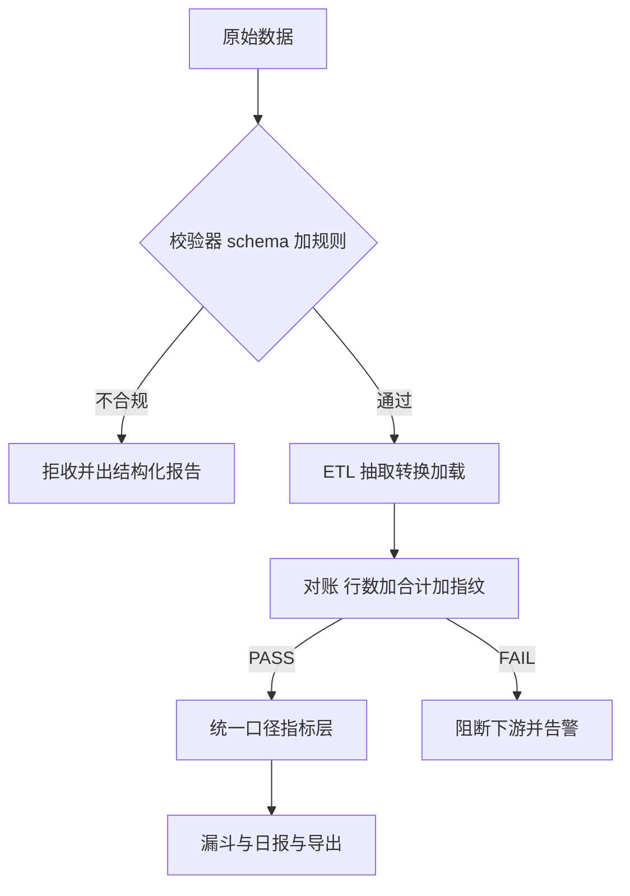

### Q2964 · 指标计算的统一口径层

> 难度:★★★☆ | 标签:指标口径, 数据一致性

**问**:面试官:两张报表的付费率对不上,你怎么从根上解决而不是对一次数?

**答**:注册制指标层:基础指标只在一处定义,派生指标引用口径而不是抄公式,compute 时做环检测。实测日报与周报从同一层取数输出完全一致;有人手抄公式把分母写成 pv,得 0.0267,口径层是 0.12——这 4.5 倍差距就是报表打架的根源。层内自检:arpu 除以 arppu 数学上恒等于 pay_rate,交叉验证 0.12=0.12,口径层自身可被对账。重名注册与指标成环 a 到 b 再回 a 都会立刻报错,把口径蔓延挡在开发期。

```python
# file: code/05_数据分析与工程化/q2964_metric_layer.py
"""指标统一口径层: 基础指标只定义一次, 派生指标引用口径而非复制公式"""
CTX = {"uv": 1000, "pv": 4500, "paid_uv": 120, "paid_amt": 9876.5}


class MetricLayer:
    """注册制指标层: name -> (依赖, 计算函数), compute 时做环检测与缓存"""

    def __init__(self):
        self._defs = {}

    def register(self, name, deps, fn):
        if name in self._defs:
            raise ValueError("指标重名: %s, 口径必须单点定义" % name)
        self._defs[name] = (list(deps), fn)

    def compute(self, name, ctx, _stack=None):
        _stack = _stack or []
        if name in _stack:
            raise ValueError("指标成环: " + " -> ".join(_stack + [name]))
        _stack.append(name)
        deps, fn = self._defs[name]
        kwargs = {d: self.compute(d, ctx, _stack) for d in deps}
        _stack.pop()
        return fn(ctx=ctx, **kwargs)

    def report(self, names, ctx):
        return {n: round(self.compute(n, ctx), 4) if isinstance(self.compute(n, ctx), float)
                else self.compute(n, ctx) for n in names}


layer = MetricLayer()
# 基础指标: 直接从上下文取数, 全公司只有这一处定义
layer.register("uv", [], lambda ctx: ctx["uv"])
layer.register("pv", [], lambda ctx: ctx["pv"])
layer.register("paid_uv", [], lambda ctx: ctx["paid_uv"])
layer.register("paid_amt", [], lambda ctx: ctx["paid_amt"])
# 派生指标: 只引用其他指标的口径, 不再写公式细节
layer.register("pv_per_uv", ["pv", "uv"], lambda pv, uv, ctx: pv / uv)
layer.register("pay_rate", ["paid_uv", "uv"], lambda paid_uv, uv, ctx: paid_uv / uv)
layer.register("arpu", ["paid_amt", "uv"], lambda paid_amt, uv, ctx: paid_amt / uv)
layer.register("arppu", ["paid_amt", "paid_uv"], lambda paid_amt, paid_uv, ctx: paid_amt / paid_uv)
# 对账型指标: arpu / arppu 数学上恒等于 pay_rate, 可用来校验口径层自身
layer.register("rate_cross_check", ["arpu", "arppu"], lambda arpu, arppu, ctx: arpu / arppu)


if __name__ == "__main__":
    names = ["uv", "pv_per_uv", "pay_rate", "arpu", "arppu"]
    print("日报口径:", layer.report(names, CTX))
    print("周报口径:", layer.report(names, CTX), "(同一层, 两张表不可能各算各的)")
    cross = layer.compute("rate_cross_check", CTX)
    print("对账: arpu/arppu =", round(cross, 4), "恒等于 pay_rate =",
          round(layer.compute("pay_rate", CTX), 4), "-> 口径层自洽")

    # 双份定义的恶果: 有人把 pay_rate 又手写了一遍且分子写错
    wrong = CTX["paid_uv"] / CTX["pv"]
    print("手抄公式得到的 pay_rate =", round(wrong, 4), "vs 口径层 =", round(layer.compute("pay_rate", CTX), 4),
          "-> 差异就是报表打架的根源")

    try:
        bad = MetricLayer()
        bad.register("a", ["b"], lambda b, ctx: b)
        bad.register("b", ["a"], lambda a, ctx: a)
        bad.compute("a", CTX)
    except ValueError as e:
        print("故意造环被拦截:", e)

    try:
        layer.register("uv", [], lambda ctx: ctx["uv"])
    except ValueError as e:
        print("故意重名被拦截:", e)
    print("要点: 口径单点定义, 派生只做引用, 重名与成环在注册和求值时立刻报错")
```

**追问**:
- 追问 1:派生链很长,性能怎么办?—— compute 加缓存,无环时拓扑求值一次,整张报表只扫一遍数据。
- 追问 2:指标定义怎么沉淀?—— 口径层序列化成指标字典:名称、公式、负责人、变更记录,改动走评审。


