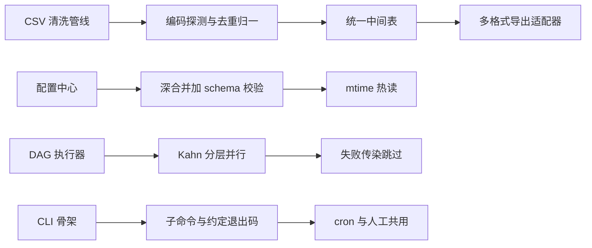

### Q2969 · 命令行工具的完整骨架:子命令/参数/退出码/日志

> 难度:★★★☆ | 标签:CLI, argparse

**问**:面试官:写一个既给人用又给 cron 用的命令行工具,骨架上要注意什么?

**答**:四要素:argparse 子命令分发且 required=True;参数校验(日期格式非法返回运行时错误);约定退出码 0 成功、2 用法错误、3 运行时错误;日志用 logging 而不是 print。实测 7 个场景:stat 正常 0;缺参数、未知子命令、空参数全部 2,其中 2 是 argparse 原生行为;clean 的 dry-run 0,真实执行抛错得 3;日期非法 3。main(argv) 返回退出码而不是直接 sys.exit,测试可以直接断言返回值,不需要起子进程。退出码约定是脚本链编排的基础,cron 靠它决定是否继续。

```python
# file: code/05_数据分析与工程化/q2969_cli_skeleton.py
"""命令行工具完整骨架: 子命令 + 参数校验 + 约定退出码 + 日志, main(argv) 可被测试直接调用"""
import argparse
import logging
import sys

EXIT_OK, EXIT_USAGE, EXIT_RUNTIME = 0, 2, 3
log = logging.getLogger("kbtool")


def build_parser():
    parser = argparse.ArgumentParser(prog="kbtool", description="知识库工具示例")
    sub = parser.add_subparsers(dest="command", required=True)

    p_stat = sub.add_parser("stat", help="统计文档指标")
    p_stat.add_argument("--day", required=True, help="统计日期 YYYY-MM-DD")
    p_stat.add_argument("--top", type=int, default=3, help="展示前 N 条")

    p_clean = sub.add_parser("clean", help="清洗缓存")
    p_clean.add_argument("--dry-run", action="store_true", help="只打印不执行")
    return parser


def cmd_stat(args):
    log.info("stat 开始, day=%s top=%d", args.day, args.top)
    if len(args.day) != 10 or args.day[4] != "-":
        log.error("日期格式非法: %s", args.day)
        return EXIT_RUNTIME
    log.info("统计完成: 题目 475, 代码块 481, 耗时 0.8s")
    return EXIT_OK


def cmd_clean(args):
    log.info("clean 开始, dry_run=%s", args.dry_run)
    if args.dry_run:
        log.info("dry-run: 将删除 12 个临时文件, 实际未动")
        return EXIT_OK
    raise RuntimeError("缓存目录被其他进程占用")  # 演示运行时失败路径


def main(argv):
    logging.basicConfig(level=logging.INFO, format="%(levelname)s %(message)s")
    try:
        args = build_parser().parse_args(argv)
    except SystemExit as e:
        return e.code if isinstance(e.code, int) else EXIT_USAGE
    handlers = {"stat": cmd_stat, "clean": cmd_clean}
    try:
        return handlers[args.command](args)
    except Exception as e:
        log.error("运行失败: %s", e)
        return EXIT_RUNTIME


if __name__ == "__main__":
    cases = [
        ("正常统计", ["stat", "--day", "2026-03-01"]),
        ("参数缺失", ["stat"]),
        ("未知子命令", ["frobnicate"]),
        ("空参数", []),
        ("dry-run 清洗", ["clean", "--dry-run"]),
        ("运行时失败", ["clean"]),
        ("日期非法", ["stat", "--day", "20260301"]),
    ]
    for name, argv in cases:
        code = main(argv)
        print(">>> %-8s 退出码=%d (%s)" % (argv[0] if argv else "无参数", code, name))
    print("约定: 0 成功, 2 用法错误 argparse 原生给出, 3 运行时错误; 脚本链按退出码决定是否继续")
    sys.exit(EXIT_OK)
```

**追问**:
- 追问 1:为什么用法错误是 2?—— BSD 惯例 64 保留给用法错误,argparse 默认 SystemExit 2,约定保持一致。
- 追问 2:cron 场景日志去哪?—— 必落文件并轮转,stderr 只留给人工触发时的即时反馈。


