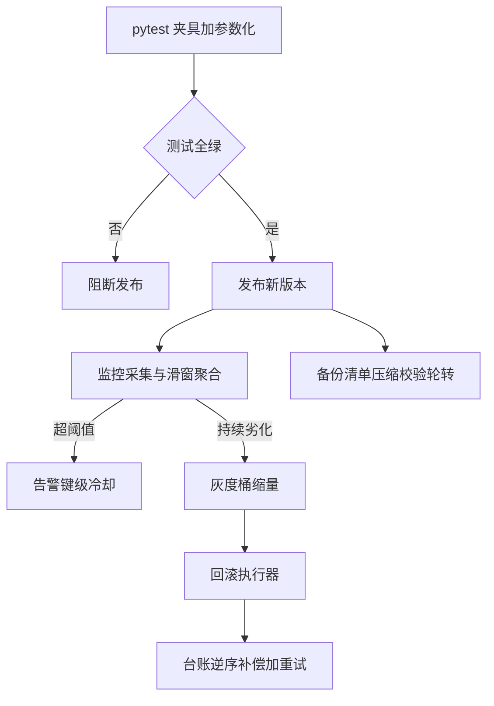

### Q2975 · 回滚的完整执行器

> 难度:★★★★ | 标签:回滚, 发布工程

**问**:面试官:线上出事要回滚,你的回滚执行器和「重新部署旧包」差在哪?

**答**:差四点。版本台账:每次发布登记制品与对应的数据库补偿脚本,回滚的原料提前备好;逆序补偿:实测 v3 回到 v1 依次执行补偿 v3、切换制品 v2、补偿 v2、切换制品 v1;干跑预案:dry-run 先列出全部步骤给值班人过目;幂等与重试:补偿过的版本重放时跳过,健康检查注入一次抖动后第 2 次尝试成功。再执行同一次回滚是幂等 no-op,目标版本不存在或想向前回滚都被拦截。回滚的本质是「提前写好的补偿脚本按台账逆放」,而不是现场救火。

```python
# file: code/05_数据分析与工程化/q2975_rollback_executor.py
"""回滚完整执行器: 版本台账 -> 逐步补偿 + 失败重试 -> 幂等重放 -> 干跑预案"""
import json


class ReleaseJournal:
    """发布台账: 只追加, 记录每个版本的制品与数据库补偿脚本"""
    def __init__(self):
        self.order = []          # ["v1", "v2", ...] 按发布顺序
        self.releases = {}       # version -> {"artifact": str, "db_comp": callable}
        self.current = None

    def release(self, version, artifact, db_comp):
        self.order.append(version)
        self.releases[version] = {"artifact": artifact, "db_comp": db_comp}
        self.current = version


HEALTH = {"fails_left": 0}


def health_check():
    """健康检查: 可注入的假探针, fails_left>0 时失败一次"""
    if HEALTH["fails_left"] > 0:
        HEALTH["fails_left"] -= 1
        raise RuntimeError("健康检查未就绪")
    return True


class RollbackExecutor:
    def __init__(self, journal, steps_log):
        self.j = journal
        self.log = steps_log
        self.db_undone = set()   # 幂等台账: 补偿过的版本不再重放

    def plan(self, target, dry_run=True):
        """从 current 逐版回退到 target, 列出将执行的补偿步骤"""
        if target not in self.j.releases:
            raise ValueError("目标版本不存在: " + target)
        ci, ti = self.j.order.index(self.j.current), self.j.order.index(target)
        if ti > ci:
            raise ValueError("目标版本比当前新, 回滚只向后走")
        steps = []
        for v in self.j.order[ci:ti:-1]:      # v3, v2 ... 直到 target 的下一版
            steps.append(("db_compensate", v))
            steps.append(("restore_artifact", self.j.order[self.j.order.index(v) - 1]))
        steps.append(("health_check", target))
        if dry_run:
            self.log.append("DRY-RUN 预案: " + " -> ".join("%s(%s)" % (a, b) for a, b in steps))
        return steps

    def run_step(self, name, fn, retries=2):
        """单步执行带重试, 全部失败则中止回滚并抛出"""
        for attempt in range(1, retries + 2):
            try:
                fn()
                self.log.append("OK  %s (第 %d 次尝试)" % (name, attempt))
                return
            except Exception as e:
                self.log.append("RETRY %s 第 %d 次失败: %s" % (name, attempt, e))
        raise RuntimeError("步骤 %s 重试耗尽" % name)

    def rollback(self, target, dry_run=False):
        steps = self.plan(target, dry_run=dry_run)
        if dry_run:
            return
        for action, ver in steps:
            if action == "db_compensate":
                if ver in self.db_undone:
                    self.log.append("SKIP db_compensate(%s) 已补偿过, 幂等跳过" % ver)
                    continue
                self.run_step("db_compensate(%s)" % ver, self.j.releases[ver]["db_comp"])
                self.db_undone.add(ver)
            elif action == "restore_artifact":
                self.run_step("restore_artifact(%s)" % ver,
                              (lambda v: lambda: self.log.append("  制品已切换至 " + v))(ver))
            else:
                self.run_step("health_check(%s)" % ver, health_check, retries=2)
        self.j.current = target
        self.log.append("DONE 当前版本回退到 " + target)


if __name__ == "__main__":
    comp_log = []
    j = ReleaseJournal()
    j.release("v1", "app-1.0.tar.gz", lambda: comp_log.append("补偿 v1: 删去 sign_path 字段回填"))
    j.release("v2", "app-1.1.tar.gz", lambda: comp_log.append("补偿 v2: 回滚订单表加列"))
    j.release("v3", "app-1.2.tar.gz", lambda: comp_log.append("补偿 v3: 恢复旧费率计算"))
    ex = RollbackExecutor(j, [])

    ex.plan("v1", dry_run=True)          # 先干跑出预案, 给值班人员过目
    HEALTH["fails_left"] = 1             # 注入一次健康检查抖动, 验证重试
    ex.rollback("v1")
    print("回滚步骤:")
    for s in ex.log:
        print("  " + s)
    print("数据库补偿执行:", comp_log)

    print("-- 幂等重放: 再次执行同一回滚 --")
    ex.log.clear()
    ex.rollback("v1") if j.current != "v1" else print("已在目标版本 v1, 回滚是幂等 no-op")

    print("-- 异常输入 --")
    for bad, args in [("不存在版本", "v9"), ("向前回滚", "v3")]:
        try:
            ex.plan(args, dry_run=True)
        except ValueError as e:
            print("  %s 被拦截: %s" % (bad, e))
    print("要点: 回滚是'提前写好的补偿脚本按台账逆放', 干跑出预案, 重试扛抖动, 幂等台账防重放事故")
```

**追问**:
- 追问 1:数据库补偿一定可行吗?—— 只有加列类可逆变更能补偿,删列类必须双写过渡,回滚策略要在发布前设计而不是出事后设计。
- 追问 2:回滚到 v1 但数据已按 v3 写入怎么办?—— 补偿脚本负责数据回填,这正是台账里每个版本挂补偿 callable 的原因。


