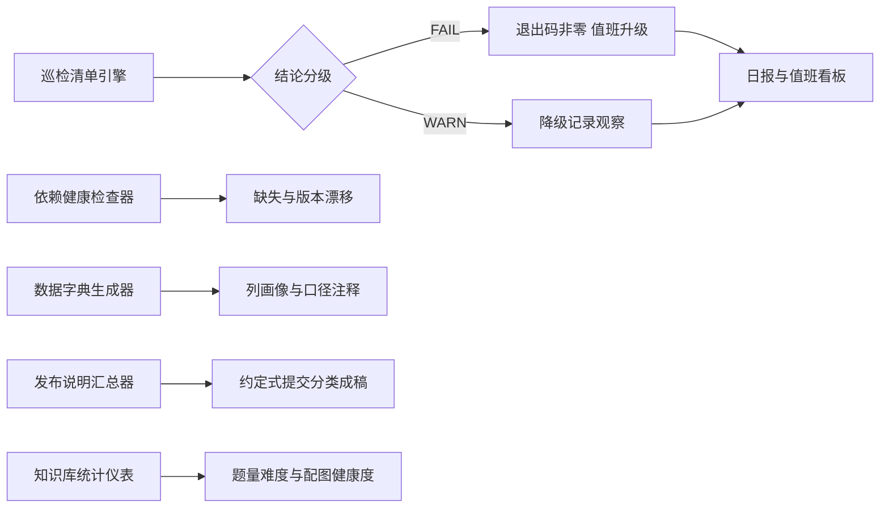

### Q2980 · 知识库的统计仪表

> 难度:★★★☆ | 标签:知识管理, 度量

**问**:面试官:知识库建起来了,你怎么度量它的健康度?

**答**:仪表扫描 markdown 目录:题数数正则标题、代码块与 mermaid 数围栏、难度分布解析星标行并自动剥掉表示空槽的半星。实测两个类目文件:合计 6 题、6 个代码块、3 张图;难度 2、3、4、5 星分别为 1、3、1、1,条形图直出;健康度指标为每题代码块 1.00、每题 mermaid 0.50。这套仪表的前提是结构化约定:题号走固定标题格式、难度走固定行、代码走围栏,约定稳定了统计就是几行正则。统计的目的是反哺写作而不是考核,3 星堆积说明缺高阶题,某标签为空说明方向缺口。

```python
# file: code/05_数据分析与工程化/q2980_kb_dashboard.py
"""知识库统计仪表: 扫描 markdown 目录 -> 统计题数/难度/代码块/mermaid -> 文本仪表盘"""
import os
import re
import tempfile
from collections import Counter

BK = chr(96) * 3   # 围栏用 chr 拼接, 避免源码与文档围栏冲突


def sample_md(title, items):
    """items: (qid, 难度, 标签, 代码块数, mermaid 数) -> 构造一份迷你知识库文件"""
    lines = ["# " + title]
    for qid, diff, tag, n_code, n_mm in items:
        lines += ["### Q%04d · 题%d" % (qid, qid), "> 难度:%s | 标签:%s" % (diff, tag)]
        for _ in range(n_code):
            lines += [BK + "python", "print(%d)" % qid, BK]
        for _ in range(n_mm):
            lines += [BK + "mermaid", "flowchart LR", "    A[节点一] --> B[节点二]", BK]
    return "\n".join(lines) + "\n"


DOC1 = sample_md("类目甲", [(1, "★★★☆", "a", 1, 0), (2, "★★☆☆", "b", 1, 1),
                            (4, "★★★☆", "d", 1, 0), (5, "★★★☆", "e", 1, 0)])
DOC2 = sample_md("类目乙", [(3, "★★★★☆", "c", 1, 0), (6, "★★★★★", "f", 1, 2)])


def analyze_file(path):
    with open(path, "r", encoding="utf-8") as f:
        text = f.read()
    return {
        "file": os.path.basename(path),
        "questions": len(re.findall(r"^### Q\d+", text, re.M)),
        "code": text.count(BK + "python"),
        "mermaid": text.count(BK + "mermaid"),
        "stars": Counter(re.findall(r"难度:(★+)", text)),
    }


def bar(n, max_n, width=24):
    if max_n == 0:
        return ""
    return "#" * max(1, round(n / max_n * width))


def render_dashboard(stats):
    totals = {"questions": sum(s["questions"] for s in stats),
              "code": sum(s["code"] for s in stats),
              "mermaid": sum(s["mermaid"] for s in stats)}
    star_totals = Counter()
    for s in stats:
        star_totals.update(s["stars"])
    lines = ["== 知识库仪表 ==", ""]
    for s in stats:
        lines.append("%-18s 题 %3d | 代码 %3d | 图 %2d"
                     % (s["file"], s["questions"], s["code"], s["mermaid"]))
    lines.append("-" * 52)
    lines.append("合计: 题目 %d, 代码块 %d, mermaid %d"
                 % (totals["questions"], totals["code"], totals["mermaid"]))
    lines.append("")
    lines.append("难度分布:")
    max_star = max(star_totals.values()) if star_totals else 0
    label = {"★": "1星", "★★": "2星", "★★★": "3星", "★★★★": "4星", "★★★★★": "5星"}
    for key in ("★", "★★", "★★★", "★★★★", "★★★★★"):
        if key in star_totals:
            lines.append("  %-5s %3d %s" % (label[key], star_totals[key],
                                            bar(star_totals[key], max_star)))
    lines.append("")
    lines.append("健康度: 每题代码块 %.2f, 每题 mermaid %.2f"
                 % (totals["code"] / max(1, totals["questions"]),
                    totals["mermaid"] / max(1, totals["questions"])))
    return "\n".join(lines)


def main():
    d = tempfile.mkdtemp(prefix="kb_")
    stats = []
    for name, doc in [("01_语言核心.md", DOC1), ("05_数据工程.md", DOC2)]:
        p = os.path.join(d, name)
        with open(p, "w", encoding="utf-8") as f:
            f.write(doc)
        stats.append(analyze_file(p))
    print(render_dashboard(stats))


if __name__ == "__main__":
    main()
    print("要点: 仪表的原料是结构化约定——题号走固定标题, 难度走星标行, 约定稳定了, 统计就是几行正则")
```

**追问**:
- 追问 1:统计怎么防止被刷?—— 题号全局唯一加代码块必须实跑,质量门槛写在约定里而不是靠事后审。
- 追问 2:仪表多久跑一次?—— 入库即统计,收尾批跑全量仪表,增量与全量结合。


