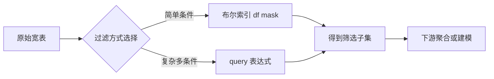

### Q313 · 布尔索引与 query 表达式

> 难度:★★☆ | 标签:pandas, 过滤

**问**:pandas 中如何做多条件过滤?query 相比布尔索引有什么优劣?

**答**:多条件过滤用 `&`、`|`、`~` 组合布尔掩码,每个条件必须加括号;query 则用字符串表达式 `df.query("a > 1 and b < 5")`,底层由 numexpr 求值,列多条件复杂时可读性更好、大表上可能更快。两者语义等价,query 的短板是字符串列名带空格、特殊字符时写法别扭,且表达式错误在运行期才暴露。工程上建议:简单条件用布尔索引,复杂多条件或需要引用外部变量用 query 的 `@var` 语法。

```python
# file: code/05_数据分析与工程化/q313_boolean_query.py
try:
    import pandas as pd
    PANDAS = True
except ImportError:
    PANDAS = False

def demo_pandas():
    df = pd.DataFrame({"a": [1, 5, 10, 15], "b": [2, 3, 4, 5], "c": list("abcd")})
    mask = (df["a"] > 2) & (df["b"] < 5)
    print(df[mask]["c"].tolist())              # 布尔索引
    print(df.query("a > 2 and b < 5")["c"].tolist())
    threshold = 10
    print(df.query("a > @threshold")["c"].tolist())  # 引用外部变量
    print(df[~df["c"].isin(["a", "b"])]["c"].tolist())  # 取反 + isin

if __name__ == "__main__":
    if PANDAS:
        demo_pandas()
    else:
        rows = [{"a": 1, "b": 2, "c": "a"}, {"a": 5, "b": 3, "c": "b"},
                {"a": 10, "b": 4, "c": "c"}, {"a": 15, "b": 5, "c": "d"}]
        print([r["c"] for r in rows if r["a"] > 2 and r["b"] < 5])
```

**追问**:
- query 里怎么引用外部变量?——`@var` 语法:`df.query("a > @threshold")`,避免 f-string 拼值带来的注入与转义问题。
- query 什么时候反而更慢?——小表上 numexpr 的解析开销大于收益;列名带特殊字符也要转义,简单条件老实用布尔索引。
- 布尔掩码怎么复用?——`mask = (df.a > 1) & (df.b < 5)` 存成变量反复组合,配合 `df.loc[mask]`,比每次重写表达式清晰。



---
