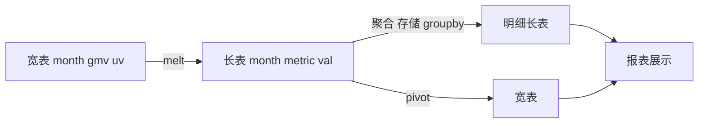

### Q317 · melt / pivot 宽表与长表转换

> 难度:★★☆ | 标签:pandas, 宽长转换

**问**:什么是宽表和长表?pandas 如何在两者之间转换?

**答**:长表是"一列指标名 + 一列值"的 tidy 数据,适合存储、聚合和画图;宽表是每个指标占一列,适合报表展示。melt 把宽转长(指定 id_vars 与 value_vars),pivot 把长转宽(index/columns/values),pivot_table 则附带聚合能力并能处理重复键。转换时注意 pivot 不允许重复的 index+columns 组合,有重复必须先聚合。

```python
# file: code/05_数据分析与工程化/q317_melt_pivot.py
try:
    import pandas as pd
    PANDAS = True
except ImportError:
    PANDAS = False

def demo_pandas():
    wide = pd.DataFrame({
        "month": ["2026-01", "2026-02"],
        "gmv": [100, 120],
        "uv": [30, 35],
    })
    long = wide.melt(id_vars="month", var_name="metric", value_name="val")
    print(long)                              # 宽转长
    back = long.pivot(index="month", columns="metric", values="val")
    back.columns.name = None
    print(back)                              # 长转宽
    # 长表带重复键时用 pivot_table 聚合
    pt = long.pivot_table(index="metric", values="val", aggfunc="sum")
    print(pt)

if __name__ == "__main__":
    if PANDAS:
        demo_pandas()
    else:
        wide = [{"month": "2026-01", "gmv": 100, "uv": 30},
                {"month": "2026-02", "gmv": 120, "uv": 35}]
        long = [{"month": r["month"], "metric": k, "val": v}
                for r in wide for k, v in r.items() if k != "month"]
        for row in long:
            print(row)
```

**追问**:
- pivot 报「Index contains duplicate entries」怎么办?——index+columns 组合有重复,先 groupby 聚合或用 pivot_table(自带 aggfunc)。
- melt 后列名怎么自定义?——`var_name=`/`value_name=` 参数;tidy 后列名规范便于后续 groupby 和画图。
- 长表和宽表怎么选存储?——明细入仓用长表(加指标维度不改动表结构);给运营看的报表用宽表,列即指标直观。



---
