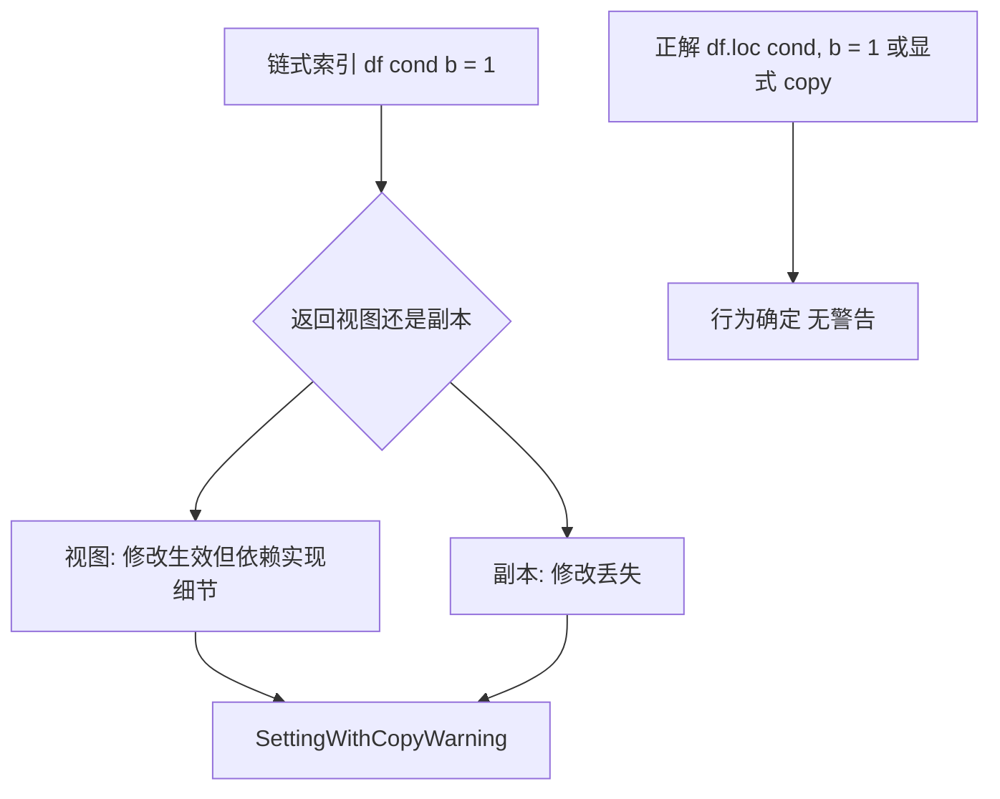

### Q320 · 链式赋值与 SettingWithCopyWarning

> 难度:★★★ | 标签:pandas, 坑

**问**:什么是链式赋值?为什么会触发 SettingWithCopyWarning,如何根治?

**答**:链式赋值指 `df[df.a > 0]["b"] = 1` 这种"两次索引拼接"的写法:第一步返回的可能是副本也可能是视图,pandas 无法确定,导致赋值可能落在临时对象上而原表未变,于是发出 SettingWithCopyWarning。根治方法是"一次 loc 完成定位与赋值":`df.loc[df.a > 0, "b"] = 1`;若确实要在切片上操作,先显式 `df2 = df[...].copy()` 摆脱歧义。新版本 pandas 引入了 Copy-on-Write,默认下修改永远不回写原表,更要靠 loc 写法保证修改生效。

```python
# file: code/05_数据分析与工程化/q320_chained_assignment.py
try:
    import pandas as pd
    PANDAS = True
except ImportError:
    PANDAS = False

def demo_pandas():
    df = pd.DataFrame({"a": [1, -2, 3], "b": [0, 0, 0]})
    # 反例:df[df.a > 0]["b"] = 1  -> SettingWithCopyWarning 且可能不生效
    df.loc[df["a"] > 0, "b"] = 1       # 正解:单次 loc 赋值
    assert (df.loc[df["a"] > 0, "b"] == 1).all()
    # 需要子表操作时显式 copy
    sub = df[df["a"] > 0].copy()
    sub["b"] = 99
    print(df, "\n---\n", sub)

if __name__ == "__main__":
    if PANDAS:
        demo_pandas()
    else:
        rows = [{"a": 1, "b": 0}, {"a": -2, "b": 0}, {"a": 3, "b": 0}]
        for r in rows:               # 单次遍历完成定位与赋值
            if r["a"] > 0:
                r["b"] = 1
        print(rows)
```

**追问**:
- Copy-on-Write 模式下行为有什么变化?——pandas 3.0 起默认 CoW:任何索引产生的都是「写时才复制」的惰性视图,链式赋值永不回写原表;旧代码要逐处 loc 化。
- 怎么区分视图和副本?——pandas 里没有可靠的公开判定,这正是警告存在的原因;规则就一条:写操作只用一次索引(loc/iloc)完成。
- 为什么改了没生效还不报错?——赋值落在临时副本上;SettingWithCopyWarning 只是警告不是错误,生产应把它升级为 errors。



---
