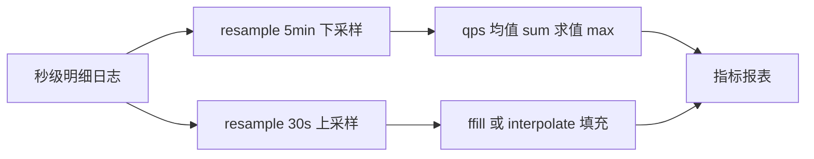

### Q325 · resample 重采样:上采样与下采样

> 难度:★★★ | 标签:pandas, 时间序列

**问**:如何把秒级日志聚合成 5 分钟指标?resample 的上采样和下采样分别怎么用?

**答**:resample 基于时间索引做分组聚合:下采样如 `df.resample("5min").agg({...})` 把细粒度聚成粗粒度,需选好聚合函数(sum/mean/last);上采样如 `.resample("1min").asfreq()` 变出更细的时间网格,会引入缺失,需配 ffill/interpolate 填充。注意闭合语义与 label 参数决定区间归属,跨天统计要用 `closed="left", label="left"` 明确口径,否则"哪一分钟的数"会对不上报表。

```python
# file: code/05_数据分析与工程化/q325_resample.py
try:
    import pandas as pd
    import numpy as np
    PANDAS = True
except ImportError:
    PANDAS = False

def demo_pandas():
    idx = pd.date_range("2026-01-01 00:00", periods=60, freq="min")
    df = pd.DataFrame({"req": np.arange(60)}, index=idx)
    down = df.resample("5min").agg(req_sum=("req", "sum"),
                                   req_max=("req", "max"))
    print(down)                          # 下采样:5 分钟窗口
    up = df.resample("30s").ffill()
    print(len(up), "rows after upsample")  # 上采样 + 前向填充

if __name__ == "__main__":
    if PANDAS:
        demo_pandas()
    else:
        from collections import defaultdict
        buckets = defaultdict(int)
        for minute in range(60):         # 5 分钟窗口求和
            buckets[minute // 5 * 5] += minute
        print(dict(sorted(buckets.items())))
```

**追问**:
- closed 和 label 的默认语义?——下采样默认 closed='left'、label='left',但以 '5min' 等对齐分钟时右端点归属易错;报表口径必须显式写出。
- 上采样的缺口怎么填?——asfreq 后接 ffill/interpolate(method='time');插值会造数,业务口径敏感的报表只能 ffill 或留空。
- resample 和 groupby+Grouper 的区别?——后者不需要 datetime 索引(可按键列分组重采样),适合 datetime 只是一列的场景。



---
