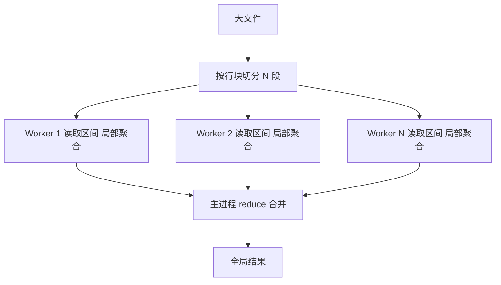

### Q328 · 多进程分块处理大文件

> 难度:★★★ | 标签:multiprocessing, ETL

**问**:如何用多进程加速对一个大 CSV 的处理?有哪些坑?

**答**:模式是"分块 → 进程池 map → 主进程 reduce":把文件按行块切分,每个 worker 独立读取自己负责的字节区间并返回聚合结果,主进程合并,避免把大 DataFrame 通过 IPC 传回。坑:worker 内重新 import pandas 的开销、不要用共享大对象(应传文件路径与偏移量)、Windows/macOS 的 spawn 启动方式要求入口函数可 pickle 且有 `if __name__ == "__main__"` 保护。CPU 密集任务用 ProcessPool,IO 密集用线程池即可。

```python
# file: code/05_数据分析与工程化/q328_multiprocess_chunks.py
import csv
import os
from concurrent.futures import ProcessPoolExecutor

CSV_PATH = "demo_mp.csv"

def write_csv(path, n=1000):
    with open(path, "w", newline="") as f:
        w = csv.writer(f)
        w.writerow(["id", "amt"])
        for i in range(n):
            w.writerow([i, i % 7 + 1])

def process_range(args):
    """每个进程只读自己的行区间,返回局部聚合。"""
    start, end = args
    total = 0.0
    with open(CSV_PATH, newline="") as f:
        for i, row in enumerate(csv.reader(f)):
            if i == 0:
                continue
            if start <= i < end:
                total += float(row[1])
            if i >= end:
                break
    return total

def main():
    n = sum(1 for _ in open(CSV_PATH)) - 1
    k = 4
    bounds = [(i * n // k, (i + 1) * n // k) for i in range(k)]
    with ProcessPoolExecutor(max_workers=k) as pool:
        partials = list(pool.map(process_range, bounds))
    print("total =", sum(partials), "partials =", partials)

if __name__ == "__main__":
    write_csv(CSV_PATH)
    main()
    os.remove(CSV_PATH)
```

**追问**:
- 为什么传文件路径而不传 DataFrame?——跨进程 pickle 大 DataFrame 的序列化开销可能超过计算本身;worker 自行按 offset 读取。
- 结果合并时怎么保持全局有序?——按块号排序聚合,或每块带 row range 元数据;乱序合并会让「前 N 行」类语义错乱。
- 什么时候不该用多进程?——IO 密集(线程池就够)、单块计算秒级以内(启动开销占比高)、或目标机器内存放不下多份 pandas。



---
