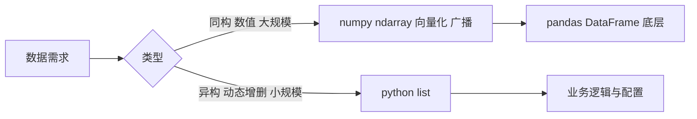

### Q330 · ndarray vs list

> 难度:★★☆ | 标签:numpy

**问**:numpy ndarray 和 Python list 有什么本质区别?各适合什么场景?

**答**:ndarray 是同构、连续内存的 C 数组,支持向量化运算、广播和 strides 视图,数值计算比 list 快一个数量级以上且省内存;list 是异构指针数组,灵活但每个元素都是完整 Python 对象。list 擅长动态增删、混合类型、小规模逻辑;ndarray 擅长大规模数值运算、矩阵代数、作为 pandas 底层。注意 ndarray 固定大小不自动扩容,append 要靠 np.concatenate 或 np.append(后者每次拷贝,应避免在循环里用)。

```python
# file: code/05_数据分析与工程化/q330_ndarray_vs_list.py
try:
    import numpy as np
except ImportError:
    print("该题演示需要第三方库 numpy:pip install numpy,原理见正文")
    raise SystemExit(0)

def main():
    py_list = [1, 2, 3, 4]
    arr = np.array([1, 2, 3, 4])
    print(type(py_list), type(arr), arr.dtype)
    print(arr * 2)                # 向量化:逐元素
    print(py_list * 2)            # list:重复拼接,语义完全不同
    print(arr + 1)                # ndarray 支持
    try:
        py_list + 1
    except TypeError as e:
        print("expected error:", e)
    print(arr.sum(), arr.mean(), arr.max())   # 内置聚合方法

if __name__ == "__main__":
    main()
```

**追问**:
- 为什么 np.append 在循环里是陷阱?——每次都整块拷贝新数组,O(n²);预分配 `np.empty` 后按位填充,或攒 list 一次性 np.array。
- ndarray 的 strides 是什么?——描述每维移动一步的字节数,切片/转置只是改 strides 不拷贝,这是视图机制的底层。
- 什么时候必须用 list?——元素类型异构、频繁增删、长度未知的小集合;ndarray 的强项是大规模同构数值。



---
