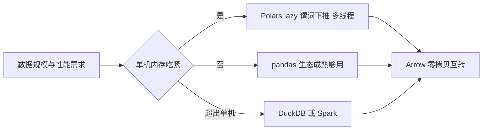

### Q333 · Polars 与 pandas 对比

> 难度:★★★ | 标签:Polars

**问**:Polars 为什么比 pandas 快?什么时候值得切换?

**答**:Polars 核心优势:基于 Rust 与 Apache Arrow 列式内存、查询优化器会对 lazy plan 做谓词下推和投影裁剪、多线程并行执行、字符串更省内存;pandas 是单线程、eager 执行、object 字符串开销大。切换时机:单机数据在 GB 级 pandas 内存/速度吃紧、流水线希望懒执行优化、或需要流式处理;保留 pandas 的场景:依赖 pandas 生态(如某些 ML 库)、小数据、团队只熟 pandas。两者可经 Arrow 零拷贝互转,渐进迁移成本低。

```python
# file: code/05_数据分析与工程化/q333_polars_compare.py
try:
    import polars as pl
    HAS_POLARS = True
except ImportError:
    HAS_POLARS = False

def demo_polars():
    df = pl.DataFrame({"city": ["BJ", "SH", "BJ"], "amt": [10, 20, 30]})
    out = (
        df.lazy()
          .filter(pl.col("amt") > 5)            # 谓词下推
          .group_by("city")
          .agg(pl.col("amt").sum().alias("total"))
          .collect()                             # 此时才执行优化后的 plan
    )
    print(out)

if __name__ == "__main__":
    if HAS_POLARS:
        demo_polars()
    else:
        # 标准库演示同语义:filter -> group -> agg
        rows = [("BJ", 10), ("SH", 20), ("BJ", 30)]
        groups = {}
        for city, amt in rows:
            if amt > 5:
                groups[city] = groups.get(city, 0) + amt
        print(groups)
```

**追问**:
- Polars 的 lazy plan 优化了什么?——谓词下推(过滤提前)、投影裁剪(只读需要的列)、连接重排;同样的逻辑比 eager pandas 少读大量数据。
- Arrow 零拷贝互转怎么做?——`df.to_arrow()`/`pl.from_arrow()`,两边共享列式内存不复制;这是迁移与混用的通道。
- pandas 还值得新项目用吗?——生态兼容(ML 库入参、可视化)仍是它最大优势;数据处理核心逐模块换 Polars/DuckDB 是务实路线。



---
