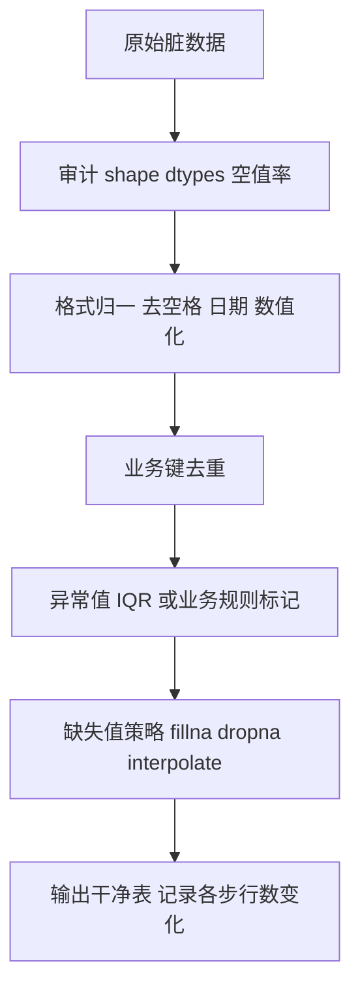

### Q335 · 数据清洗实战:去重、异常值 IQR、格式归一

> 难度:★★★ | 标签:pandas, 数据清洗

**问**:拿到一份脏数据,你的标准清洗流程包含哪些步骤?

**答**:典型流程:先审计(shape、dtypes、空值率、describe),再按序处理——格式归一(去空格、统一大小写、日期解析、字符串数值化)→ 去重(dup 判断依据业务键而不是全行)→ 异常值(业务规则优先,统计上用 IQR 或 z-score 标记而非直接删除)→ 缺失值按 Q314 策略处理。关键原则:每一步清洗前后记录行数变化,清洗逻辑代码化可重跑,不允许人工在 Excel 里改数。

```python
# file: code/05_数据分析与工程化/q335_data_cleaning.py
try:
    import pandas as pd
    import numpy as np
    PANDAS = True
except ImportError:
    PANDAS = False

def clean(df):
    n0 = len(df)
    # 1 格式归一
    df["city"] = df["city"].str.strip().str.upper()
    df["amt"] = pd.to_numeric(df["amt"], errors="coerce")
    # 2 按业务键去重
    df = df.drop_duplicates(subset=["order_id"], keep="last")
    # 3 IQR 标记异常值(标记而非删除)
    q1, q3 = df["amt"].quantile([0.25, 0.75])
    iqr = q3 - q1
    lo, hi = q1 - 1.5 * iqr, q3 + 1.5 * iqr
    df["amt_outlier"] = (df["amt"] < lo) | (df["amt"] > hi)
    print(f"rows {n0} -> {len(df)}, outliers={int(df['amt_outlier'].sum())}")
    return df

if __name__ == "__main__":
    if PANDAS:
        df = pd.DataFrame({
            "order_id": [1, 2, 2, 3, 4],
            "city": [" BJ", "sh", " SZ ", "BJ", "gz"],
            "amt": ["10", "20", "20", "9999", "5"],
        })
        print(clean(df))
    else:
        rows = [(1, "BJ", 10), (2, "SH", 20), (2, "SH", 20), (3, "BJ", 9999)]
        seen, cleaned = set(), []
        for oid, city, amt in rows:      # 去重的标准库等价
            if oid not in seen:
                seen.add(oid)
                cleaned.append((oid, city.strip().upper(), amt))
        vals = sorted(c[2] for c in cleaned)
        q1, q3 = vals[len(vals) // 4], vals[3 * len(vals) // 4]
        iqr = q3 - q1
        for oid, city, amt in cleaned:
            flag = amt < q1 - 1.5 * iqr or amt > q3 + 1.5 * iqr
            print(oid, city, amt, "outlier" if flag else "ok")
```

**追问**:
- 去重按全行还是业务键?——全行重复可 drop;业务键重复是数据质量问题(可能一新一旧),要先按更新时间保留最新并记录冲突。
- IQR 异常值该删吗?——不该直接删:先区分录入错误(修正/剔除)与真实长尾(保留);风控、反作弊场景异常本身就是信号。
- 清洗为什么必须代码化?——人工改数不可重跑、不可审计;每步保留输入输出与行数日志,任何口径质疑都能重放。



---
