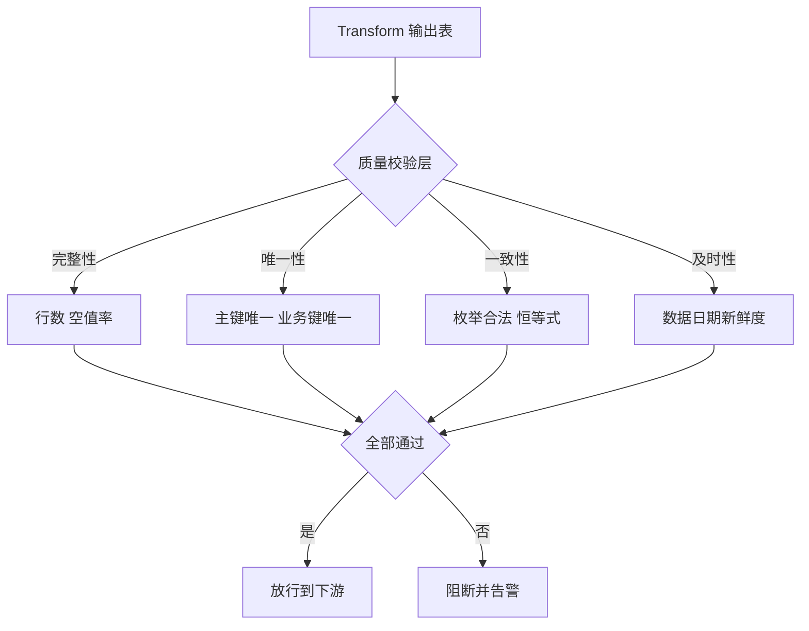

### Q337 · 数据质量校验:行数、唯一性、空值率断言

> 难度:★★★ | 标签:数据质量, 断言

**问**:如何在数据管道中嵌入数据质量校验?一般校验哪些维度?

**答**:四大维度:完整性(行数在预期区间、关键列空值率低于阈值)、唯一性(主键/业务键唯一)、一致性(枚举值合法、外键可关联、指标满足恒等式如金额=单价×数量)、及时性(数据日期不滞后)。工程上做成独立校验层:每条规则产出 pass/fail 与样本,失败时阻断下游或降级告警;规则配置化而不是 if-else 散落。原则是"坏数据进不来、坏数据走不远"。

```python
# file: code/05_数据分析与工程化/q337_quality_checks.py
try:
    import pandas as pd
    PANDAS = True
except ImportError:
    PANDAS = False

class QualityReport:
    def __init__(self):
        self.results = []

    def check(self, name, ok, detail=""):
        self.results.append((name, ok, detail))

    def assert_all(self):
        failed = [r for r in self.results if not r[1]]
        for name, ok, detail in self.results:
            print(("PASS" if ok else "FAIL"), name, detail)
        if failed:
            raise AssertionError(f"{len(failed)} quality checks failed")

def run_checks(df, expect_min_rows=1):
    rep = QualityReport()
    rep.check("row_count", len(df) >= expect_min_rows, f"rows={len(df)}")
    rep.check("pk_unique", df["order_id"].is_unique)
    rep.check("null_rate", df["amt"].isna().mean() < 0.1,
              f"null_rate={df['amt'].isna().mean():.2%}")
    rep.check("amt_positive", (df["amt"] > 0).all())
    rep.assert_all()
    return rep

if __name__ == "__main__":
    if PANDAS:
        good = pd.DataFrame({"order_id": [1, 2], "amt": [10.0, 20.0]})
        run_checks(good)
        try:
            bad = pd.DataFrame({"order_id": [1, 1], "amt": [10.0, None]})
            run_checks(bad)
        except AssertionError as e:
            print("blocked:", e)
    else:
        rows = [(1, 10.0), (2, 20.0)]
        ids = [r[0] for r in rows]
        print("pk_unique:", len(ids) == len(set(ids)))
        print("amt_positive:", all(r[1] > 0 for r in rows))
```

**追问**:
- 校验失败阻断还是告警?——按规则分级:主键唯一性、行数骤降属于阻断;空值率小幅上升告警观察;一刀切阻断会让管道不可用。
- 行数漂移阈值怎么定?——与上一周期对比的相对阈值(如 ±20%)加绝对下限;大促等已知波动日走白名单。
- 恒等式校验举例?——订单金额 = 单价×数量(容差)、汇总表 = 明细聚合结果;恒等式被破坏往往精确暴露口径或漏数问题。



---
