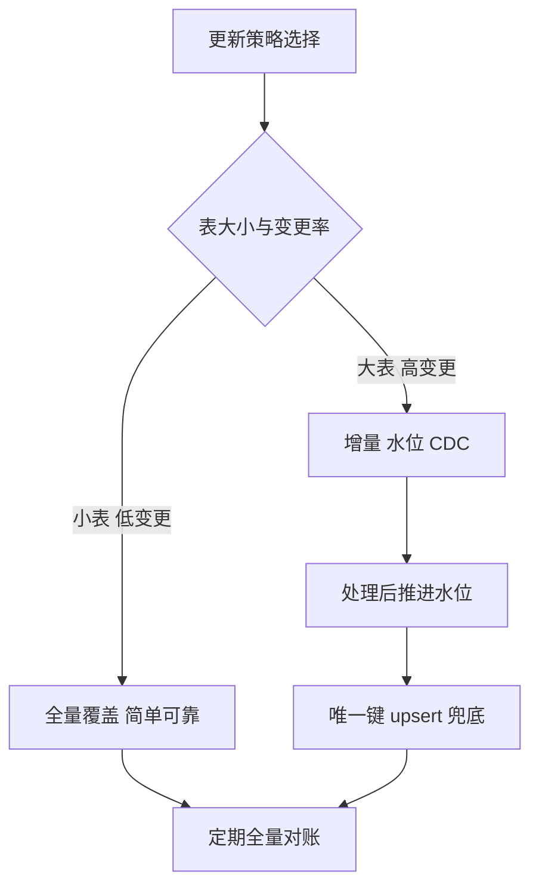

### Q339 · 增量与全量更新策略

> 难度:★★★ | 标签:增量同步, 数据仓库

**问**:目标表更新用全量刷还是增量追?如何选择和实现增量?

**答**:选择依据:表大小与变更比例。小维表直接全量覆盖(简单可靠);大事实表用增量——基于更新时间戳水位(CDC)、自增 ID、或源库 binlog 捕获变更。实现要点:水位存在独立的元数据表,处理成功后才推进水位(先处理后提交,避免丢数);增量必须容忍乱序与重复,下游以唯一键 upsert 兜底。周期性做一次全量对账,弥补增量遗漏,这是生产上"增量为主、全量兜底"的标准组合。

```python
# file: code/05_数据分析与工程化/q339_incremental.py
import json
import os

STATE = "watermark.json"

def read_watermark(default="1970-01-01T00:00:00"):
    if os.path.exists(STATE):
        return json.load(open(STATE)).get("watermark", default)
    return default

def fetch_incremental(source_rows, watermark):
    """模拟按更新时间拉增量,生产上对应 SQL: WHERE updated_at > watermark"""
    return sorted(
        [r for r in source_rows if r["updated_at"] > watermark],
        key=lambda r: r["updated_at"],
    )

def apply_upsert(rows, table):
    for r in rows:
        table[r["id"]] = r             # 唯一键 upsert 兜底乱序重复

if __name__ == "__main__":
    source = [
        {"id": 1, "updated_at": "2026-11-01T01:00:00"},
        {"id": 2, "updated_at": "2026-11-01T02:00:00"},
        {"id": 1, "updated_at": "2026-11-01T03:00:00"},   # 同键更新
    ]
    table = {}
    wm = read_watermark()
    inc = fetch_incremental(source, wm)
    apply_upsert(inc, table)
    if inc:                             # 处理成功后才推进水位
        new_wm = inc[-1]["updated_at"]
        json.dump({"watermark": new_wm}, open(STATE, "w"))
    print("rows:", table, "watermark:", read_watermark())
    os.remove(STATE)
```

**追问**:
- 增量水位的三种来源怎么选?——更新时间戳最简单但要源表维护索引;binlog CDC 最可靠但引入订阅组件;自增 ID 只能捕捉新增捕捉不了更新。
- 乱序与重复为什么必然出现?——源库时钟漂移、重试、分区并行;所以下游一律唯一键 upsert,不假设顺序。
- 全量对账怎么做?——周期性对比源与目标的关键指标(行数、校验和、金额合计),差异进入修复队列;增量遗漏靠它兜底。



---
