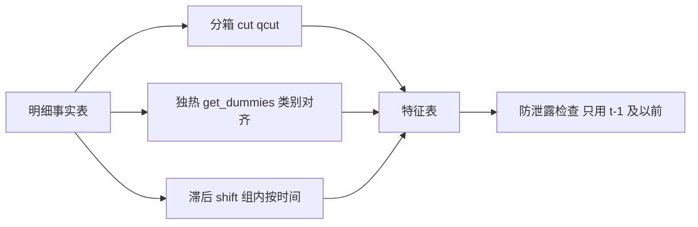

### Q342 · 特征工程基础:分箱、独热、滞后特征

> 难度:★★★ | 标签:特征工程, pandas

**问**:用 pandas 做特征工程,分箱、独热编码和滞后特征分别怎么实现?要注意什么?

**答**:分箱用 `pd.cut`(等宽/自定义边界)或 `pd.qcut`(等频),优先 qcut 避免某箱样本过少;独热用 `pd.get_dummies`,生产上要注意训练/推理的类别集合一致,建议保存类别清单对齐;滞后特征用 `groupby().shift(n)`,必须按时间排序后组内 shift,且注意前 n 行是 NaN,严防"用未来数据"造成的特征泄露。三类操作都应封装成可复用的转换函数,输入输出 DataFrame,方便进管道测试。

```python
# file: code/05_数据分析与工程化/q342_feature_eng.py
try:
    import pandas as pd
    import numpy as np
    PANDAS = True
except ImportError:
    PANDAS = False

def build_features(df):
    # 分箱:等频分 3 档
    df["amt_bin"] = pd.qcut(df["amt"], q=3, labels=["low", "mid", "high"])
    # 独热
    df = pd.get_dummies(df, columns=["city"], prefix="city")
    # 滞后特征:按用户按时间组内 shift,防泄露
    df = df.sort_values(["uid", "ts"])
    df["amt_prev"] = df.groupby("uid")["amt"].shift(1)
    df["amt_diff"] = df["amt"] - df["amt_prev"]
    return df

if __name__ == "__main__":
    if PANDAS:
        df = pd.DataFrame({
            "uid": [1, 1, 2, 2, 1],
            "ts": pd.to_datetime(["2026-01-01", "2026-01-02",
                                  "2026-01-01", "2026-01-02", "2026-01-03"]),
            "city": ["BJ", "BJ", "SH", "SH", "BJ"],
            "amt": [10.0, 30.0, 20.0, 25.0, 50.0],
        })
        print(build_features(df))
    else:
        print("标准库思路:排序后用 zip(cur, prev) 构造滞后列,分箱用边界列表判断")
```

**追问**:
- 特征泄露的典型场景?——按时间排序后整表 shift(组间串数据)、用了未来统计量(全量均值、目标编码);train/valid 集成时先切时间再算特征。
- get_dummies 训练/推理类别不一致怎么办?——保存训练类别清单,推理时 reindex 对齐补 0;sklearn 的 OneHotEncoder(handle_unknown='ignore') 内置此逻辑。
- qcut 和 cut 怎么选?——希望每箱样本均衡用 qcut(等频);业务边界明确(年龄段)用 cut 自定义 bins;分箱边界要保存进模型产物。



---
