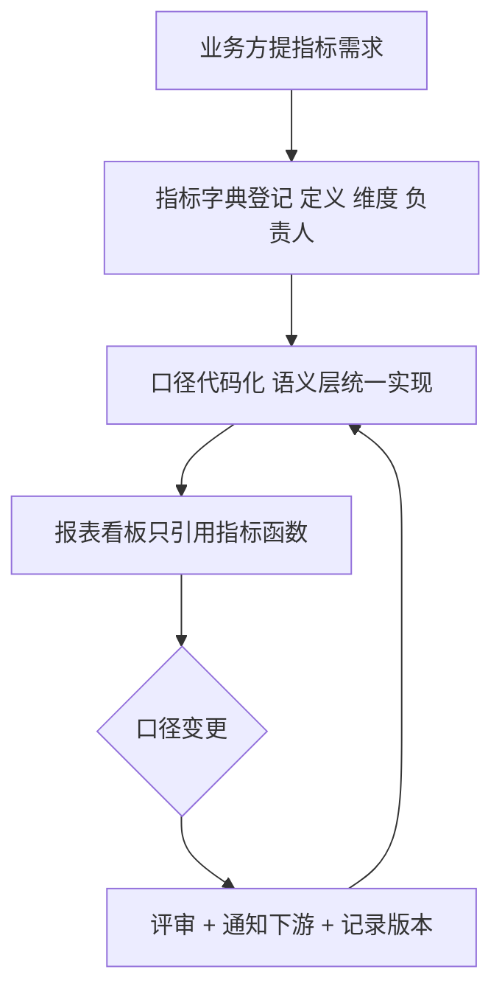

### Q348 · 指标口径管理

> 难度:★★★ | 标签:指标, 治理

**问**:为什么"GMV 对不上"是数据团队的经典事故?如何治理指标口径?

**答**:根因是同一指标名有多个实现:GMV 是否含退款、是否含运费、按下单时间还是支付时间——各报表各写一遍 SQL,必然对不上。治理手段:①指标字典:指标名、业务定义、计算公式、维度、负责人、变更记录集中登记;②口径代码化:核心指标封装成统一函数/SQL 片段或语义层(dbt metrics、metrics store),报表只引用不重写;③变更流程:口径修改必须评审并通知所有下游。面试要点:口径问题本质是组织问题,技术方案(语义层)只是把共识固化下来。

```python
# file: code/05_数据分析与工程化/q348_metric_registry.py
try:
    import pandas as pd
    PANDAS = True
except ImportError:
    PANDAS = False

# 指标字典:定义与实现绑定,消费方只调函数不写 SQL
METRIC_REGISTRY = {
    "gmv_paid": {
        "desc": "支付成功订单金额之和, 不含退款",
        "impl": lambda df: df.loc[df["status"] == "paid", "amount"].sum(),
    },
    "gmv_created": {
        "desc": "全部下单金额, 含未支付与退款",
        "impl": lambda df: df["amount"].sum(),
    },
    "refund_rate": {
        "desc": "退款金额 占 gmv_paid 比例",
        "impl": lambda df: (df.loc[df["status"] == "refunded", "amount"].sum()
                            / METRIC_REGISTRY["gmv_paid"]["impl"](df)),
    },
}

def compute(df, metric):
    return METRIC_REGISTRY[metric]["impl"](df)

if __name__ == "__main__":
    if PANDAS:
        df = pd.DataFrame({"status": ["paid", "created", "refunded"],
                           "amount": [100.0, 20.0, 10.0]})
        for m in METRIC_REGISTRY:
            print(m, "=", round(compute(df, m), 4))
    else:
        print("标准库思路:字典存定义与 lambda,同样可实现统一口径")
```

**追问**:
- 指标口径冲突的信号?——两份报表同名指标对不上且都能自圆其说;治理从「指认唯一负责人」开始,技术其次。
- 语义层解决什么?——把口径写一次、处处引用(dbt metrics/Headless BI);报表 SQL 不再各自实现 GMV。
- 口径变更的流程?——评审影响面(血缘列下游)→ 双跑对照一个周期 → 通知下游切换 → 记录变更日志;直接改是事故源。



---
