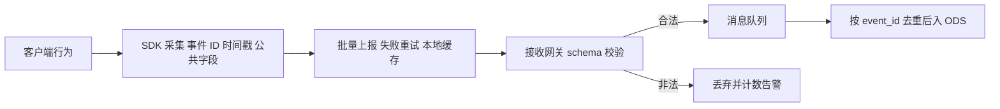

### Q350 · 行为日志埋点设计

> 难度:★★★ | 标签:埋点, 数据采集

**问**:设计一套用户行为埋点方案,要考虑哪些字段和工程问题?

**答**:事件模型采用"who-when-where-what":公共字段(user_id/匿名 ID、时间戳、设备与 app 版本、会话 ID、SDK 采集的服务端时间)+ 事件专有字段(事件名、页面、元素、参数)。工程要点:①客户端时间不可信,以服务端接收时间兜底并记录偏差;②事件名与参数 schema 化管理,防止埋点自由发挥;③埋点分级(P0/P1)控制成本;④上报走批量 + 失败重试 + 本地缓存,网络差时不能丢事件;⑤唯一事件 ID 去重,防止重试导致重复计数。

```python
# file: code/05_数据分析与工程化/q350_event_tracking.py
import json
import uuid
from datetime import datetime, timezone

REQUIRED_PUBLIC = ["event_id", "user_id", "event_name", "client_ts", "server_ts"]

def build_event(user_id, event_name, props):
    now = datetime.now(timezone.utc).isoformat()
    return {
        "event_id": str(uuid.uuid4()),     # 唯一 ID,服务端去重依据
        "user_id": user_id,
        "event_name": event_name,
        "client_ts": props.get("client_ts", now),
        "server_ts": now,                  # 服务端时间为准
        "props": props,                    # schema 校验后入库
    }

def validate(ev):
    missing = [k for k in REQUIRED_PUBLIC if not ev.get(k)]
    return not missing, missing

if __name__ == "__main__":
    ev = build_event("u1", "page_view",
                     {"page": "home", "client_ts": "2026-11-01T10:00:00+08:00"})
    ok, missing = validate(ev)
    assert ok
    print(json.dumps(ev, ensure_ascii=False, indent=2))
```

**追问**:
- 客户端时间和服务端时间怎么取舍?——以服务端接收时间为准排序,客户端时间做参考并记录偏差;设备改时间会让纯客户端排序错乱。
- 埋点 schema 怎么管理?——事件字典(名称、参数、类型、负责人、版本)评审入库,上报前校验;自由发挥的埋点等于不可用。
- 重试导致重复事件怎么去重?——每事件生成唯一 UUID,服务端按 ID 去重;批量上报失败重试是常态,不去重数据必然虚高。



---
