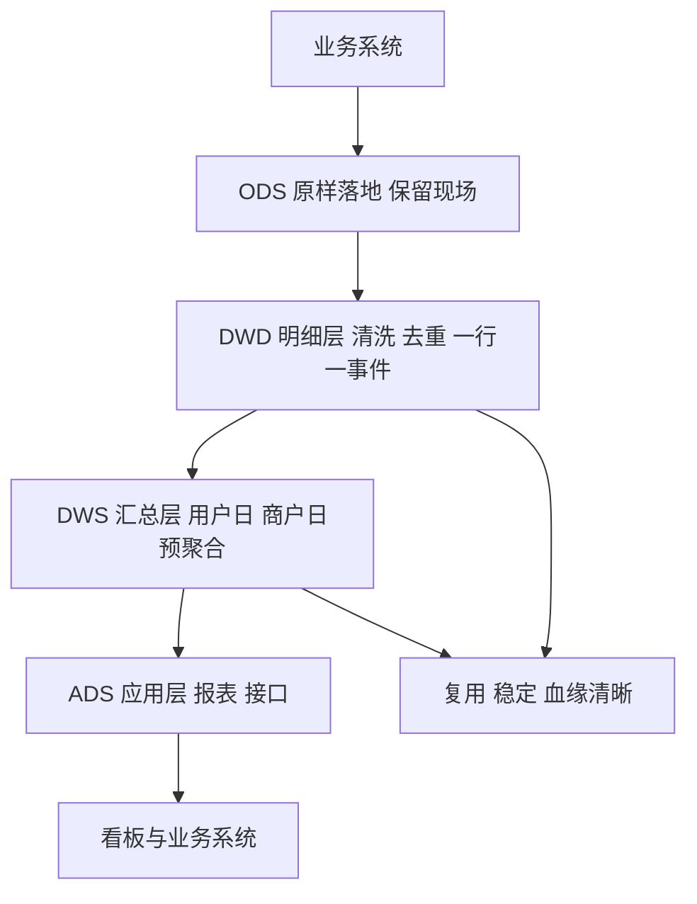

### Q355 · 数据仓库分层 ODS / DWD / DWS / ADS

> 难度:★★★ | 标签:数仓, 分层

**问**:数仓为什么分层?各层职责是什么?

**答**:分层是为了解耦"采集、清洗、汇总、应用"的变化频率:ODS 原样落地源数据(不做清洗,保留现场);DWD 明细事实层,做清洗、去重、维度退化,一行一个业务事件;DWS 汇总层,按主题和常用粒度预聚合(用户日、商户日);ADS 应用层,直接服务报表和接口。价值:①下游只依赖稳定中间层,源表变更不扩散;②复用计算,避免烟囱式开发;③血缘清晰便于治理。反面模式是 ODS 直连 ADS 的"一条 SQL 到底",改口径时全场爆炸。

```python
# file: code/05_数据分析与工程化/q355_dw_layers.py
"""用纯函数模拟数仓分层:每层只依赖下一层,输入输出明确。"""

def ods_to_dwd(raw_rows):
    """清洗:去重 + 过滤非法,一行一个事件。"""
    seen, dwd = set(), []
    for r in raw_rows:
        key = (r["order_id"], r["uid"])
        if key in seen or r["amount"] <= 0:
            continue
        seen.add(key)
        dwd.append({"order_id": r["order_id"], "uid": r["uid"],
                    "amount": r["amount"], "dt": r["dt"]})
    return dwd

def dwd_to_dws(dwd_rows):
    """按用户按天汇总。"""
    agg = {}
    for r in dwd_rows:
        k = (r["uid"], r["dt"])
        amt, cnt = agg.get(k, (0.0, 0))
        agg[k] = (amt + r["amount"], cnt + 1)
    return [{"uid": u, "dt": d, "amt": a, "cnt": c} for (u, d), (a, c) in agg.items()]

def dws_to_ads(dws_rows):
    """应用层:直接可用的报表行。"""
    return sorted(dws_rows, key=lambda r: -r["amt"])[:3]

if __name__ == "__main__":
    raw = [{"order_id": 1, "uid": "u1", "amount": 100, "dt": "2026-11-01"},
           {"order_id": 1, "uid": "u1", "amount": 100, "dt": "2026-11-01"},
           {"order_id": 2, "uid": "u2", "amount": 50, "dt": "2026-11-01"}]
    dwd = ods_to_dwd(raw)
    dws = dwd_to_dws(dwd)
    ads = dws_to_ads(dws)
    print("ODS", len(raw), "-> DWD", len(dwd), "-> DWS", dws, "-> ADS", ads)
```

**追问**:
- ODS 为什么不做清洗?——保留现场供追溯与重放;清洗错误在 ODS 层可重放修复,清了就回不去了。
- DWS 和 ADS 的边界?——DWS 按主题与稳定粒度预聚合(用户日),ADS 面向具体报表;ADS 直连 ODS 的烟囱开发是反模式。
- 分层的代价是什么?——存储与链路变长、时效下降;所以实时需求走流式旁路,分层主要服务离线治理。



---
