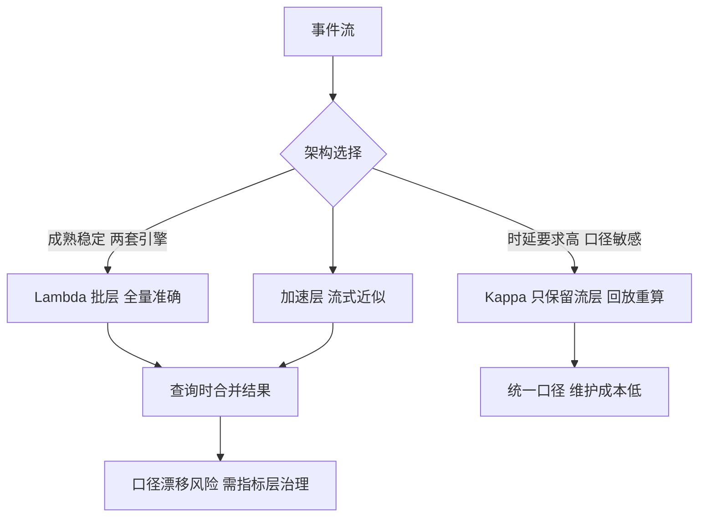

### Q360 · 实时与离线:Lambda 与 Kappa 架构

> 难度:★★★ | 标签:架构, 流批一体

**问**:实时数仓为什么难做?Lambda 和 Kappa 架构的区别是什么?

**答**:难点在"同口径算两遍":Lambda 架构分批处理层(全量、准、慢)与加速层(流式、快、近似),查询时合并结果——稳定但两套代码两套口径,维护成本翻倍。Kappa 架构只保留流处理层,一切皆流,需要重算历史时把消息队列保留期拉长或回放日志,口径天然统一,但对消息存储和 Flink 类引擎要求高。现实工程常取折中:核心高时效指标走流式,其余走离线,通过统一指标层(见 Q348)保证批流口径一致。选型依据是业务对时延的真实需求,而不是技术时髦度。

```python
# file: code/05_数据分析与工程化/q360_lambda_kappa.py
from collections import deque

class KappaPipeline:
    """概念级 Kappa:一切皆流, 重算 = 回放日志。
    批处理等价于一次性回放全部历史事件。"""

    def __init__(self, window=3):
        self.log = deque()               # 持久化的事件日志
        self.window = window

    def append(self, value):
        self.log.append(value)

    def current_view(self):
        vals = list(self.log)[-self.window:]
        return sum(vals) / len(vals) if vals else None

    def recompute(self):
        """回放全量日志重算视图:与增量视图口径一致。"""
        vals = list(self.log)[-self.window:]
        return sum(vals) / len(vals) if vals else None

if __name__ == "__main__":
    p = KappaPipeline(window=3)
    for v in [1, 2, 3, 4]:
        p.append(v)
    assert p.current_view() == p.recompute(), "批流口径必须一致"
    print("view:", p.current_view(), "= recompute:", p.recompute())
```

**追问**:
- 两套口径为什么必然漂移?——批流实现的窗口语义、乱序处理、去重逻辑不同;解法是统一指标定义 + 定期对账,而不是寄望实现一致。
- Kappa 重算历史怎么落地?——消息保留期拉长(成本高)或从源数据回放重建流;重算窗口大时 Kappa 优势减弱。
- 怎么判断业务需要实时?——指标驱动即时决策(风控、推荐)才需要秒级;T+1 可满足的报表上实时是纯成本。



---

全章完:Q311–Q360 共 50 题,覆盖 pandas/numpy 核心机制、数据清洗、ETL 工程、数仓建模、指标治理与实时架构。
