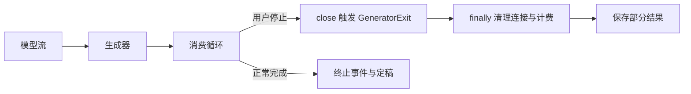

### Q1133 · 流式取消:半途停止与资源清理

> 难度:★★★★ | 标签:流式, 取消, 资源管理

**问**:用户在流式输出中途点了"停止生成",服务端要怎么干净地取消?资源怎么清理?

**答**:Python 里生成器被 `close()` 时会在挂起点抛出 `GeneratorExit`,`finally` 块必然执行,这是实现清理的钩子。工程上要做三件事:立即停止向上游计费(关闭连接);把已生成部分持久化为"部分结果"而不是丢掉;给下游发一个 `cancelled` 终止事件,让 UI 状态机退出"生成中"。还要注意不能在 `GeneratorExit` 里再 yield,否则抛 RuntimeError。

```python
# file: code/06_Agent与LLM及系统设计/q1133_stream_cancel.py
"""流式取消:生成器在 close 时于 finally 中做清理,保留部分结果并标记取消。"""


def token_stream(tokens, billing, partials):
    produced = []
    try:
        for t in tokens:
            produced.append(t)
            billing["tokens"] += 1      # 每片都计费,取消后必须停止
            yield t
        billing["finished"] = True
    except GeneratorExit:
        billing["cancelled"] = True
        partials.append("".join(produced))  # 部分结果持久化
        raise                                # GeneratorExit 必须继续抛出
    finally:
        billing["connections"] -= 1          # 连接/上游资源必释放


if __name__ == "__main__":
    billing = {"tokens": 0, "finished": False, "cancelled": False, "connections": 1}
    partials = []
    gen = token_stream(iter(["你", "好", "世", "界"]), billing, partials)
    out = []
    for i, tok in enumerate(gen):
        out.append(tok)
        if i == 1:
            gen.close()                       # 用户点击停止
    assert billing["cancelled"] and not billing["finished"]
    assert billing["tokens"] == 2, "取消后不再计费"
    assert billing["connections"] == 0, "连接已清理"
    assert partials == ["你好"], "部分结果已保存"
    print("取消成功:计费", billing["tokens"], "片,部分结果:", partials[0])
```

**追问**:
- 上游不是生成器而是 HTTP 连接怎么办?答:在单独线程收流并检测取消标志,收到后关闭 socket,读循环以异常退出,同样走 finally 清理。
- 部分结果要不要算钱?答:按已产出的 token 计费是行业惯例,但要在产品上明示。


