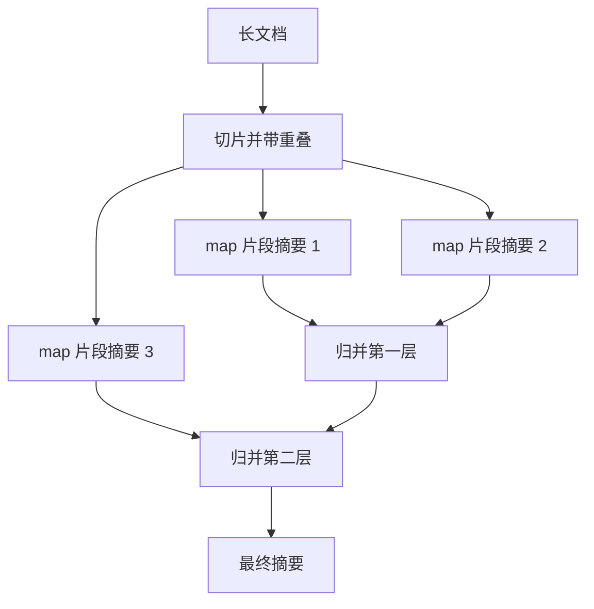

### Q1139 · 分片 map-reduce 长文摘要

> 难度:★★★☆ | 标签:上下文管理, 并行

**问**:一份 200 页文档要摘要,远超窗口,经典 map-reduce 怎么做?有什么坑?

**答**:map 阶段把文档切成互有重叠的分片,各片独立并行摘要;reduce 阶段把分片摘要合并做最终摘要。三个坑:一是分片切断语义,需要 10%-20% 重叠或按章节边界切;二是 reduce 阶段本身也可能超窗,需要多级归并(树形 reduce);三是 map 摘要丢失全局信息,可在 map prompt 里注入文档目录或前文摘要作为"全局视角"。每片要带序号,最终引用才能溯源到原文位置。

```python
# file: code/06_Agent与LLM及系统设计/q1139_map_reduce_summary.py
"""长文 map-reduce 摘要:分片并行摘要 + 树形归并,支持两级 reduce 防超窗。"""


class FakeLLM:
    def summarize(self, text, max_chars=40):
        # 桩:取每段首句模拟"抽取式摘要"
        sents = [s.strip() for s in text.replace("。", "。\n").split("\n") if s.strip()]
        return "。".join(s.content if hasattr(s, "content") else s for s in sents[:2])[:max_chars]


def chunk(doc, size=200, overlap=40):
    step = size - overlap
    return [doc[i:i + size] for i in range(0, len(doc), step)]


def map_reduce(llm, doc, fan_out=3):
    parts = chunk(doc)
    summaries = [llm.summarize(p) for p in parts]           # map 阶段可并行
    while len(summaries) > 1:                                # 树形归并防 reduce 超窗
        nxt = []
        for i in range(0, len(summaries), fan_out):
            group = summaries[i:i + fan_out]
            merged = " / ".join(f"片段{i+j}:{s}" for j, s in enumerate(group))
            nxt.append(llm.summarize(merged, max_chars=60) if len(group) > 1 else group[0])
        summaries = nxt
    return summaries[0], len(parts)


if __name__ == "__main__":
    llm = FakeLLM()
    doc = "第一章介绍了系统架构。系统分为四层。第二章讲检索增强。检索质量决定答案上限。" * 30
    summary, n_parts = map_reduce(llm, doc)
    print(f"原文 {len(doc)} 字 -> {n_parts} 片")
    print("最终摘要:", summary)
    assert n_parts >= 5 and 0 < len(summary) <= 80
    print("map-reduce 完成,reduce 未超窗")
```

**追问**:
- 想要"全文要点列表"而不是叙事摘要怎么办?答:map 输出结构化要点(带分片号),reduce 只做去重合并,不做二次生成,信息保真度更高。
- 片与片之间有依赖结论怎么办?答:先抽实体与结论做全局索引(类 GraphRAG 思路),reduce 时把相关实体结论注入,而不是纯文本归并。


