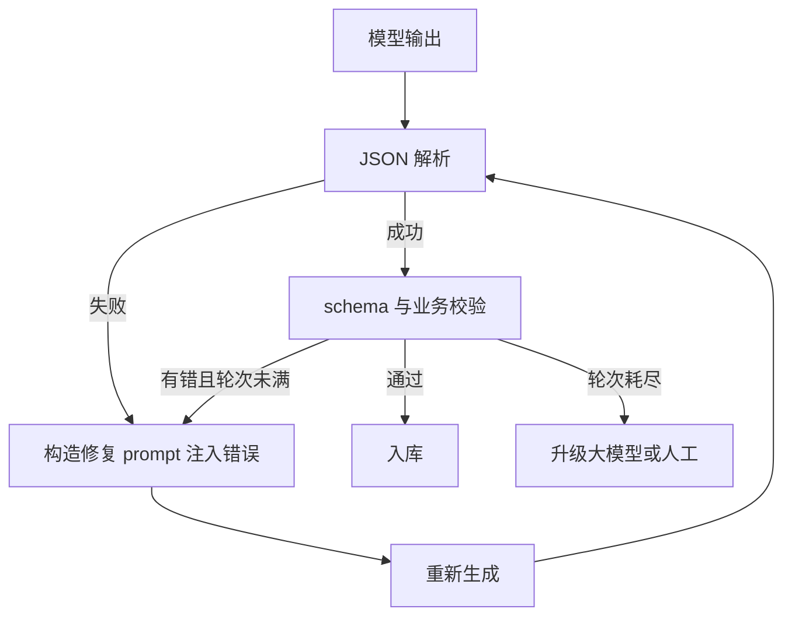

### Q1146 · 校验失败自动修复提示

> 难度:★★★☆ | 标签:结构化输出, 修复

**问**:校验失败后,怎么构造"修复 prompt"让模型一次改对?

**答**:修复 prompt 要素:原任务、上次输出、具体错误列表(带 JSON path)、schema 节选、明确指令"只输出修正后的完整 JSON"。要点是错误信息必须机器可读地注入,而不是把校验日志整段贴进去;另外修复轮次要限制,通常 2 轮封顶,防止模型在同一个坑反复跳。修复成功后必须重新走完整校验,不允许"修复后免检"。

```python
# file: code/06_Agent与LLM及系统设计/q1146_auto_repair_prompt.py
"""校验失败自动修复:错误注入 prompt,修复后重新全量校验,轮次封顶。"""
import json


def validate(obj):
    errs = []
    if "city" not in obj or not obj["city"]:
        errs.append("$.city: 必填,非空字符串")
    if not isinstance(obj.get("days"), int) or obj["days"] < 1:
        errs.append("$.days: 必须是 >=1 的整数")
    return errs


class RepairLLM:
    """第一次给坏输出,收到修复提示后给好输出的桩。"""

    def __init__(self):
        self.fixed = False

    def generate(self, prompt):
        if "只输出修正后的完整 JSON" in prompt:
            self.fixed = True
            return json.dumps({"city": "广州", "days": 2})
        return json.dumps({"city": "", "days": 0})


def run_with_repair(llm, task, schema_hint, max_repairs=2):
    raw = llm.generate(task)
    for i in range(max_repairs + 1):
        errs = validate(json.loads(raw))
        if not errs:
            return json.loads(raw), i
        repair_prompt = (
            f"原任务:{task}\n上次输出:{raw}\n错误列表:{json.dumps(errs, ensure_ascii=False)}\n"
            f"schema 提示:{schema_hint}\n只输出修正后的完整 JSON,不要解释。"
        )
        raw = llm.generate(repair_prompt)
    raise ValueError("修复轮次耗尽")


if __name__ == "__main__":
    llm = RepairLLM()
    obj, rounds = run_with_repair(llm, "提取行程信息", '{"city": str, "days": int>=1}')
    print(f"修复 {rounds} 轮后通过:", obj)
    assert obj == {"city": "广州", "days": 2}
    assert llm.fixed and rounds == 1, "应恰好一轮修复成功"
    print("修复后重新全量校验,闭环成立")
```

**追问**:
- 模型总在同一字段犯错怎么办?答:该字段换获取方式——加 few-shot 示例、改约束解码、或从"生成"改成"从候选列表选择",别无限修复。
- 修复 prompt 会不会越修越偏?答:把"只输出 JSON"和 schema 放在消息最末尾强化注意力,且每次修复基于原始输出而非上一轮修复链。


