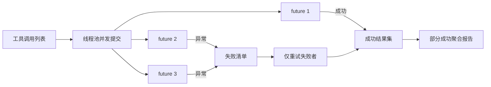

### Q1152 · 并行工具的失败隔离与部分结果

> 难度:★★★☆ | 标签:工具调用, 并发

**问**:并行调 5 个工具挂了 2 个,怎么做到"部分成功也算成功"?怎么只重试失败的?

**答**:用 `ThreadPoolExecutor.map` 会因单个异常丢失全部结果,正确姿势是用 `as_completed` 逐个收割 future,把成功与失败分别收集,返回结构化的部分结果对象。只重试失败者:把失败任务的输入保留,重试策略与单任务一致(预算+退避),成功者不重复执行(幂等保护靠任务级 idem key)。聚合报告要区分:全部成功、部分成功(带失败清单)、全部失败(触发上层降级)。

```python
# file: code/06_Agent与LLM及系统设计/q1152_partial_results.py
"""并行工具失败隔离:as_completed 收割,部分结果 + 失败者精准重试。"""
from concurrent.futures import ThreadPoolExecutor, as_completed
import random


def tool(name, fail_names):
    def run(arg):
        if name in fail_names:
            raise ConnectionError(f"{name} 下游超时")
        return f"{name}({arg})=OK"
    return run


def run_parallel(tasks, fail_names, max_workers=4):
    results, errors = {}, {}
    with ThreadPoolExecutor(max_workers=max_workers) as ex:
        futs = {ex.submit(tool(n, fail_names), arg): n for n, arg in tasks}
        for fut in as_completed(futs):
            name = futs[fut]
            try:
                results[name] = fut.result()
            except Exception as e:
                errors[name] = str(e)
    return results, errors


def retry_failed(tasks, fail_names, attempts=2):
    for i in range(attempts):
        _, errors = run_parallel(tasks, fail_names=set())
        if not errors:
            return {"recovered": [n for n, _ in tasks], "rounds": i + 1}
        tasks = [t for t in tasks if t[0] in errors]
    return {"recovered": [], "rounds": attempts}


if __name__ == "__main__":
    random.seed(1)
    tasks = [("flight", "北京"), ("hotel", "北京"), ("weather", "北京"), ("traffic", "北京")]
    results, errors = run_parallel(tasks, fail_names={"hotel", "traffic"})
    print("成功:", results)
    print("失败:", errors)
    assert len(results) == 2 and len(errors) == 2, "失败必须被隔离"

    r = retry_failed([("hotel", "北京"), ("traffic", "北京")], set())
    print("失败者重试:", r)
    assert r["recovered"] == ["hotel", "traffic"], "成功者不重复执行,失败者精准重试"
    print("部分成功聚合: 2 成功 + 2 已恢复")
```

**追问**:
- 部分结果怎么喂给模型继续推理?答:在 prompt 里明确标注"哪些成功哪些失败及原因",让模型决定降级路径,比硬造占位数据诚实且安全。
- 某个工具 90% 概率失败拖慢整体怎么办?答:给每个 future 设独立超时与快速失败,长尾工具降级为异步补全,不阻塞主链路。


