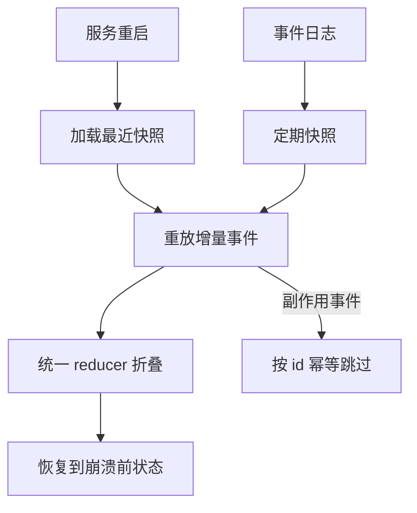

### Q1157 · 会话恢复与事件重放

> 难度:★★★★ | 标签:事件溯源, 会话

**问**:服务迁移或崩溃后,怎么把会话恢复到崩溃前的精确状态?重放为什么快?

**答**:事件溯源思路:会话的所有变更(用户消息、助手回复、工具调用、审批)都记为不可变事件,当前状态是事件序列折叠的结果。恢复时从最近快照开始,只重放快照之后的增量事件,复杂度从 O(全部事件) 降到 O(快照间隔)。要点:事件必须带 schema 版本与单调序号;重放函数必须与线上写入共用同一份 reducer,否则"重放的过去"与"真实的过去"分叉;外部副作用(发短信)不能在重放中重复执行,要用"已执行标记"跳过。

```python
# file: code/06_Agent与LLM及系统设计/q1157_event_replay.py
"""事件溯源会话:快照 + 增量重放恢复状态,副作用事件幂等跳过。"""


def reducer(state, ev):
    """唯一的状态折叠函数:线上写入与恢复重放共用。"""
    t = ev["type"]
    if t == "user_msg":
        state["messages"].append(("user", ev["text"]))
    elif t == "assistant_msg":
        state["messages"].append(("assistant", ev["text"]))
    elif t == "slot":
        state["slots"][ev["key"]] = ev["value"]
    elif t == "side_effect":                       # 外部副作用
        if ev["id"] not in state["done_effects"]:
            state["done_effects"].add(ev["id"])
            state["effects_executed"] += 1
    return state


class SessionLog:
    def __init__(self):
        self.events, self.snapshot_at = [], -1
        self.snapshot = None

    def append(self, ev):
        ev["seq"] = len(self.events)
        self.events.append(ev)

    def take_snapshot(self, state):
        self.snapshot, self.snapshot_at = state, len(self.events) - 1

    def restore(self):
        import copy
        if self.snapshot is None:
            state = {"messages": [], "slots": {}, "done_effects": set(), "effects_executed": 0}
            start = 0
        else:
            state = copy.deepcopy(self.snapshot)
            state["done_effects"] = set(state["done_effects"])
            start = self.snapshot_at + 1
        for ev in self.events[start:]:
            state = reducer(state, ev)
        return state


if __name__ == "__main__":
    log = SessionLog()
    for ev in [{"type": "user_msg", "text": "订酒店"}, {"type": "slot", "key": "city", "value": "上海"},
               {"type": "side_effect", "id": "sms-1"}]:
        log.append(ev)
    state = log.restore()
    print("全量重放:", state["messages"], state["slots"], "副作用执行", state["effects_executed"])
    log.take_snapshot(state)
    log.append({"type": "assistant_msg", "text": "已订好上海酒店"})
    log.append({"type": "side_effect", "id": "sms-1"})   # 重放中会再次出现
    state2 = log.restore()
    assert state2["effects_executed"] == 1, "副作用必须幂等,重放不重复执行"
    assert state2["messages"][-1] == ("assistant", "已订好上海酒店")
    print("快照后增量重放 2 条事件,副作用去重生效")
```

**追问**:
- 快照间隔怎么选?答:按恢复时长预算反推(如重放 <100ms),事件速率高的会话加密快照;快照本身也要版本化。
- reducer 要改逻辑怎么办?答:upcasting——老事件按版本升格为新格式再进新 reducer;禁止原地改 reducer 语义后直接重放老日志。


