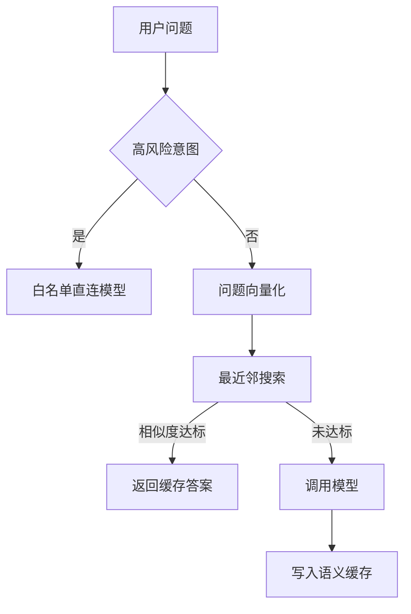

### Q1161 · 语义缓存:假嵌入相似度命中

> 难度:★★★★ | 标签:缓存, 向量

**问**:换个问法就想命中缓存,语义缓存怎么做?误命中的代价怎么控制?

**答**:语义缓存把 query 向量化,与缓存条目做最近邻搜索,相似度超阈值即返回缓存答案。三个工程点:阈值是准确率-命中率旋钮,客服域 0.92 起步;缓存条目要带"适用条件"(租户、语言、上下文版本),不是纯语义相近就能复用;答案含时效信息(价格、库存)禁止进语义缓存或带极短 TTL。误命中比不命中更危险(答非所问),所以高风险意图走白名单直连,不做语义缓存。

```python
# file: code/06_Agent与LLM及系统设计/q1161_semantic_cache.py
"""语义缓存:hash 假嵌入 + 余弦最近邻 + 阈值门控 + 高风险白名单直连。"""
import hashlib, math, re


def embed(text, dim=64):
    v = [0.0] * dim
    for tok in re.findall(r"[\u4e00-\u9fff]|[a-z0-9]+", text.lower()):
        v[int(hashlib.md5(tok.encode()).hexdigest(), 16) % dim] += 1.0
    n = math.sqrt(sum(x * x for x in v)) or 1.0
    return [x / n for x in v]


def cosine(a, b):
    return sum(x * y for x, y in zip(a, b))


class SemanticCache:
    def __init__(self, threshold=0.5):
        self.entries, self.threshold = [], threshold

    def lookup(self, q):
        if not self.entries:
            return None
        qv = embed(q)
        best = max(self.entries, key=lambda e: cosine(qv, e["vec"]))
        sim = cosine(qv, best["vec"])
        return (best["answer"], sim) if sim >= self.threshold else None

    def put(self, q, answer):
        self.entries.append({"q": q, "vec": embed(q), "answer": answer})


class Service:
    RISKY = ["退款", "投诉", "法律"]

    def __init__(self, threshold=0.5):
        self.cache = SemanticCache(threshold)
        self.calls = 0

    def _llm(self, q):
        self.calls += 1
        return f"LLM 回答:{q}"

    def ask(self, q):
        if any(k in q for k in self.RISKY):
            return self._llm(q) + " [高风险直连]"
        hit = self.cache.lookup(q)
        if hit:
            return f"{hit[0]} [缓存命中 sim={hit[1]:.2f}]"
        ans = self._llm(q)
        self.cache.put(q, ans)
        return ans


if __name__ == "__main__":
    s = Service()
    print(s.ask("怎么查物流"))                       # miss,入库
    print(s.ask("帮我查一下物流信息"))               # 语义近似,hit
    print(s.ask("退货退款流程"))                     # 高风险直连
    print(s.ask("今天天气怎么样"))                   # 不相关,miss
    assert s.calls == 3, "一次命中 + 高风险直连 + 一次不相关 miss = 3 次 LLM"
    print(f"LLM 调用 {s.calls} 次(4 次请求),相似命中与白名单直连生效,不相关问题未命中")
```

**追问**:
- 阈值太高全 miss、太低乱命中,怎么调?答:用标注对(同义/非同义)离线找最优分隔阈值,并按意图分域设不同阈值;上线后监控"缓存命中后的负反馈率"动态收紧。
- 为什么语义缓存通常只存问答对不存会话中间态?答:中间态与上下文强耦合,语义相似但上下文不同复用必然错,缓存粒度要定在无状态的单问单答。


