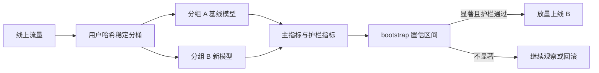

### Q1166 · A/B 模型对比与显著性检验桩

> 难度:★★★★ | 标签:实验, 统计

**问**:两个模型 A/B 实验,差异 0.3% 就能下结论吗?怎么避免误判?

**答**:不能。要过三关:样本量(按最小可检测差异和方差估,N 太小一切免谈)、统计显著性(假设检验或 bootstrap 置信区间,p<0.05 且效应方向一致)、业务显著性(差异在最小业务价值之上)。工程细节:分桶必须互斥且用户级稳定;实验期覆盖完整周期(避免工作日/周末偏差);多指标要看主指标+护栏指标,主指标涨但护栏崩(延迟、成本、投诉率)也不能上。下面的桩用 bootstrap 演示置信区间。

```python
# file: code/06_Agent与LLM及系统设计/q1166_ab_test.py
"""A/B 对比:用户稳定分桶 + bootstrap 置信区间 + 护栏指标联合决策。"""
import hashlib, random, statistics


def assign(user_id, seed="exp-1"):
    # hash() 对字符串加盐,跨进程/重启会漂移;必须用稳定摘要保证用户级稳定归属
    digest = hashlib.sha256(f"{seed}:{user_id}".encode("utf-8")).digest()
    return "A" if (digest[0] % 2 == 0) else "B"


def bootstrap_diff(a, b, iters=2000, seed=7):
    rng = random.Random(seed)
    diffs = []
    for _ in range(iters):
        sa = [a[rng.randrange(len(a))] for _ in a]
        sb = [b[rng.randrange(len(b))] for _ in b]
        diffs.append(statistics.mean(sb) - statistics.mean(sa))
    diffs.sort()
    lo, hi = diffs[int(iters * 0.025)], diffs[int(iters * 0.975)]
    return lo, hi


if __name__ == "__main__":
    random.seed(11)
    users = [f"u{i}" for i in range(600)]
    groups = {u: assign(u) for u in users}
    # 真实差异 +0.03,B 更好
    scores = {u: 0.70 + (0.03 if groups[u] == "B" else 0) + random.gauss(0, 0.15)
              for u in users}
    a = [scores[u] for u in users if groups[u] == "A"]
    b = [scores[u] for u in users if groups[u] == "B"]
    lo, hi = bootstrap_diff(a, b)
    print(f"A 均值 {statistics.mean(a):.3f}  B 均值 {statistics.mean(b):.3f}")
    print(f"差值 95% CI = [{lo:+.3f}, {hi:+.3f}]")
    sig = lo > 0
    print("统计显著(置信区间不含 0):", sig)

    guardrails = {"p95_latency_ms": (420, 400), "cost_per_req": (0.021, 0.020)}
    ok_guard = all(new <= old for old, new in guardrails.values())
    decision = "上线 B" if sig and ok_guard else "继续观察或回滚"
    print("护栏:", guardrails, "->", decision)
    assert isinstance(sig, bool) and lo < hi, "置信区间顺序合理"
```

**追问**:
- 中途偷看结果算显著就停,有什么问题?答:多重比较膨胀假阳性,应预先定样本量与检验时点,或用序贯检验方法,偷看必须修正阈值。
- 效应小但业务重要怎么加速实验?答:提高灵敏度——配对设计(同请求双跑)、方差缩减(CUPED 思路用先验协变量)、聚焦高流量分层,而不是硬拉实验时长。


