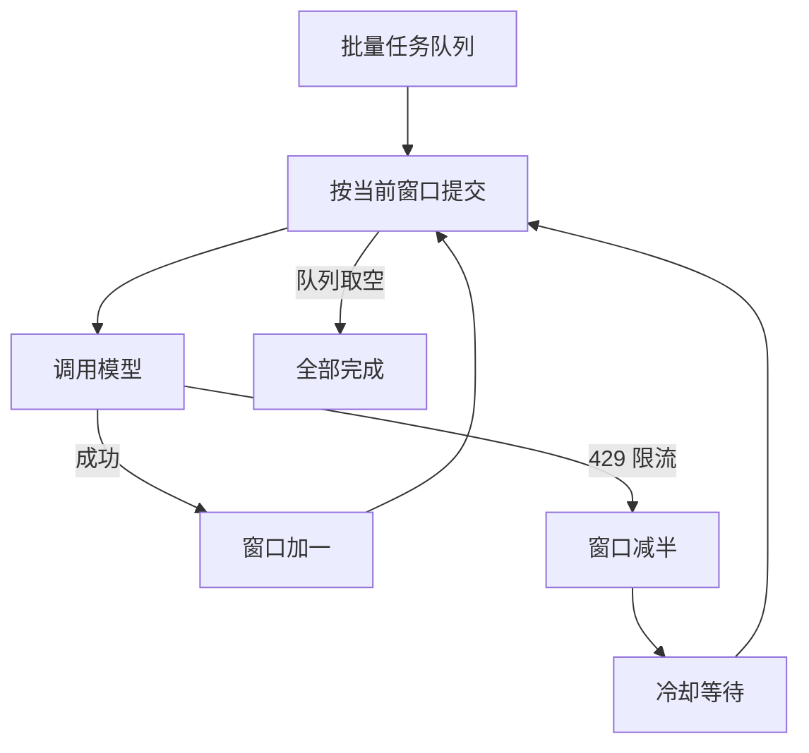

### Q1171 · 并发请求编排与自适应限速

> 难度:★★★★ | 标签:并发, 限流

**问**:批量任务要打 1 万次 LLM 调用,怎么自适应限速才能既快又不触发 429?

**答**:自适应限速器维护当前并发数,像 TCP 拥塞窗口一样工作:成功则缓慢增加(加性增),遇到 429/超时则乘性减(减半),带冷却时间防抖。任务用有界队列提交,worker 数等于当前窗口,窗口变化实时生效。配合请求级预算与全局 P95 监控:窗口增大但 P95 恶化说明下游饱和,要回撤。这个模式对"批量离线打标、评测跑分、数据蒸馏"都是核心件。

```python
# file: code/06_Agent与LLM及系统设计/q1171_adaptive_concurrency.py
"""自适应并发:加性增乘性减 AIMD,429 退避,任务池随窗口伸缩。"""
import random, threading, time
from concurrent.futures import ThreadPoolExecutor


class AdaptiveLimiter:
    def __init__(self, initial=2, max_c=16):
        self.limit, self.max_c = initial, max_c
        self.lock = threading.Lock()
        self.cooldown_until = 0

    @property
    def value(self):
        return self.limit

    def on_success(self):
        with self.lock:
            self.limit = min(self.max_c, self.limit + 1)   # 加性增

    def on_429(self):
        with self.lock:
            self.limit = max(1, self.limit // 2)            # 乘性减
            self.cooldown_until = time.monotonic() + 0.05

    def wait_gate(self):
        while time.monotonic() < self.cooldown_until:
            time.sleep(0.005)


class BatchRunner:
    def __init__(self, llm, limiter):
        self.llm, self.limiter = llm, limiter

    def call(self, q):
        self.limiter.wait_gate()
        try:
            r = self.llm(q)
            self.limiter.on_success()
            return r
        except RuntimeError:
            self.limiter.on_429()
            raise

    def run(self, questions):
        done, pending = [], list(questions)
        while pending:
            batch, pending = pending[: self.limiter.value], pending[self.limiter.value:]
            try:
                with ThreadPoolExecutor(max_workers=self.limiter.value) as ex:
                    done += list(ex.map(self.call, batch))
            except RuntimeError:
                pending = batch + pending                  # 429 的整批退回重跑
        return done


class FlakyLLM:
    def __init__(self):
        self.calls = 0

    def __call__(self, q):
        self.calls += 1
        if self.calls in (3, 7):
            raise RuntimeError("429 Too Many Requests")
        return f"ok:{q}"


if __name__ == "__main__":
    runner = BatchRunner(FlakyLLM(), AdaptiveLimiter(initial=2))
    out = runner.run([f"q{i}" for i in range(12)])
    print("完成", len(out), "条,最终窗口", runner.limiter.value)
    assert len(out) == 12, "429 任务必须全部重试成功"
    assert runner.limiter.value >= 2
    print("AIMD 自适应限速收敛,窗口自动恢复")
```

**追问**:
- 增速为什么是加性而降速是乘性?答:AIMD 保证收敛且公平——增长要保守防雪崩,退让要果断防连锁故障,这是被 TCP 验证过的稳定策略。
- 离线批任务和在线流量抢资源怎么办?答:离线任务限制为容量的固定份额(如 60%),或挪到低峰窗口,配额体系里离线是可被抢占的低优先级。


