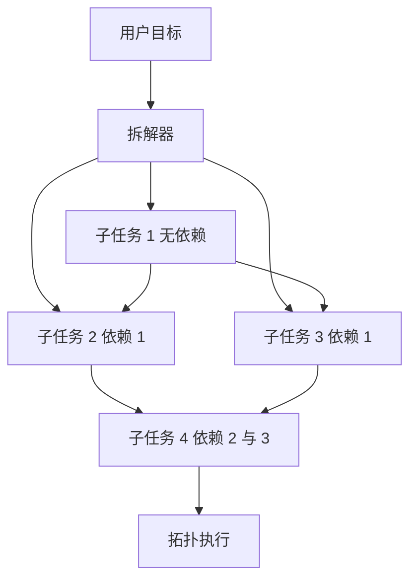

### Q1178 · 任务分解器:目标拆解为子任务图

> 难度:★★★☆ | 标签:任务分解, 规划

**问**:用户给一个目标,Agent 怎么拆解成可执行的子任务图?拆错了怎么办?

**答**:拆解器输出 DAG:节点是子任务(带类型、输入输出、预计成本),边是依赖。实现两档:规则模板拆解(意图匹配到固定模板,稳定便宜)、LLM 拆解(自由目标,需校验)。校验是关键:检查输出 schema(每个子任务有 id 与依赖列表)、依赖无环、叶子任务可执行(有对应工具)、依赖引用存在。拆解错误的兜底:执行中发现前置缺失时支持"动态插入子任务",但要防止无限细分(深度与总量上限)。

```python
# file: code/06_Agent与LLM及系统设计/q1178_task_decomposer.py
"""任务分解器:规则模板拆解 + LLM 拆解校验(无环/引用合法/叶子可执行)。"""
import json


TOOLBOX = {"search", "calculator", "writer", "chart"}


class Decomposer:
    def rule_based(self, goal):
        if "报告" in goal:
            tasks = [
                {"id": "t1", "type": "search", "deps": [], "desc": "收集数据"},
                {"id": "t2", "type": "calculator", "deps": ["t1"], "desc": "计算指标"},
                {"id": "t3", "type": "writer", "deps": ["t1", "t2"], "desc": "撰写报告"},
                {"id": "t4", "type": "chart", "deps": ["t2"], "desc": "生成图表"},
            ]
            return tasks, "ok"
        return [{"id": "t1", "type": "search", "deps": [], "desc": goal}], "ok"

    def llm_based(self, goal):
        # FakeLLM 桩:返回一个含错误依赖的拆解,演示校验拦截
        raw = json.dumps([
            {"id": "a", "type": "search", "deps": [], "desc": "查"},
            {"id": "b", "type": "writer", "deps": ["a", "c"], "desc": "写"},
            {"id": "c", "type": "chart", "deps": ["b"], "desc": "图"},
        ])
        return self._validate(raw)

    def _validate(self, raw):
        try:
            tasks = json.loads(raw)
        except json.JSONDecodeError:
            return None, "JSON 不合法"
        ids = {t["id"] for t in tasks}
        for t in tasks:
            if t["type"] not in TOOLBOX:
                return None, f"任务 {t['id']} 类型不可执行 {t['type']}"
            for d in t["deps"]:
                if d not in ids:
                    return None, f"任务 {t['id']} 依赖不存在的 {d}"
        # 环检测:Kahn
        indeg = {t["id"]: 0 for t in tasks}
        for t in tasks:
            for d in t["deps"]:
                indeg[t["id"]] += 1
        queue, seen = [i for i, v in indeg.items() if v == 0], 0
        adj = {t["id"]: [x["id"] for x in tasks if t["id"] in x["deps"]] for t in tasks}
        while queue:
            n = queue.pop()
            seen += 1
            for m in adj[n]:
                indeg[m] -= 1
                if indeg[m] == 0:
                    queue.append(m)
        if seen != len(tasks):
            return None, "依赖存在环"
        return tasks, "ok"


if __name__ == "__main__":
    d = Decomposer()
    ok_tasks, status = d.rule_based("生成季度报告")
    print("模板拆解:", [(t["id"], t["type"]) for t in ok_tasks], status)
    assert status == "ok" and ok_tasks[2]["deps"] == ["t1", "t2"]

    bad, why = d.llm_based("自由目标")
    print("LLM 拆解校验:", why, "(b 与 c 互相依赖)")
    assert bad is None and "环" in why, "循环依赖必须被拦截"
    print("校验器把不合格拆解挡在执行前")
```

**追问**:
- 拆解粒度怎么定?答:叶子任务必须满足"单工具可完成 + 输出可校验",粒度过细通信开销爆炸,过粗则单步失败重试代价大。
- 动态插任务怎么防失控?答:设最大任务数与最大深度硬上限,超限时收敛为"汇报已完成的 + 人工介入"。


