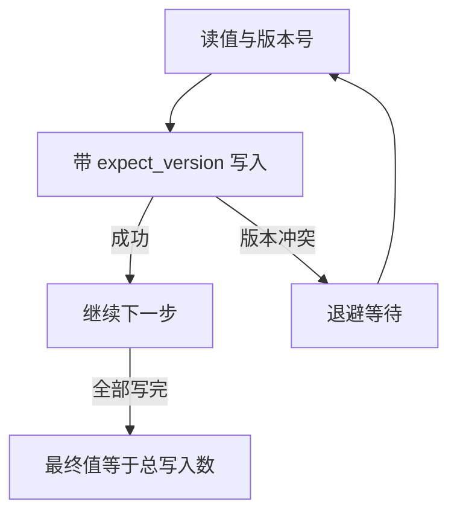

### Q1183 · 共享内存一致性:版本号乐观并发

> 难度:★★★★ | 标签:多 Agent, 并发

**问**:多个 Agent 线程共享一个状态仓库,怎么保证不出现丢失更新?

**答**:首选乐观并发:读时拿版本号,写时带 expect_version 做 CAS(compare-and-swap),冲突则重试。多 Agent 场景选乐观而非悲观锁的理由:冲突率通常低(各自任务不同字段),悲观锁容易造成长事务与死锁。实现三件:版本号单调递增、写路径原子(锁保护单条记录而非全局)、重试带上限与退避。读多写少或字段彼此独立时,还可以分片锁(按 key 哈希到多个锁)进一步降低竞争。

```python
# file: code/06_Agent与LLM及系统设计/q1183_shared_memory_cas.py
"""共享状态仓库:乐观并发 CAS + 冲突重试 + 分片锁。"""
import threading, time


class ShardedStore:
    def __init__(self, shards=4):
        self.shards = [({}, threading.Lock()) for _ in range(shards)]

    def _shard(self, key):
        return self.shards[hash(key) % len(self.shards)]

    def read(self, key):
        d, lk = self._shard(key)
        with lk:
            return d.get(key)

    def cas(self, key, value, expect_version):
        d, lk = self._shard(key)
        with lk:
            cur = d.get(key, {"value": None, "version": 0})
            if cur["version"] != expect_version:
                return False, cur["version"]
            d[key] = {"value": value, "version": expect_version + 1}
            return True, expect_version + 1


def worker(store, key, n_writes, success_counter):
    for _ in range(n_writes):
        for attempt in range(50):                  # 重试上限
            cur = store.read(key)
            v = (cur["value"] or 0) if cur else 0
            ok, _ = store.cas(key, v + 1, cur["version"] if cur else 0)
            if ok:
                success_counter[0] += 1
                break
            time.sleep(0.001 * (attempt + 1))      # 退避
        else:
            raise RuntimeError("重试耗尽")


if __name__ == "__main__":
    store = ShardedStore()
    key = "shared_counter"
    success = [0]
    threads = [threading.Thread(target=worker, args=(store, key, 50, success)) for _ in range(4)]
    for t in threads:
        t.start()
    for t in threads:
        t.join()
    final = store.read(key)
    print(f"4 线程各写 50 次,成功 CAS {success[0]} 次,最终值 {final['value']}")
    assert success[0] == 200 and final["value"] == 200, "任何丢失更新都会导致计数偏小"
    print("无丢失更新:乐观并发 + 冲突退避重试收敛")
```

**追问**:
- 什么时候必须用悲观锁?答:单次写成本极高(如触发的副作用不可撤销)且冲突率高时,先锁后写比重试划算;或者写操作无法用"值覆盖"表达时。
- 版本号溢出/回绕要不要管?答:64 位版本号实际不会溢出;真正要防的是"旧快照复活"(ABA),版本号单调递增天然防 ABA,比指针方案安全。


