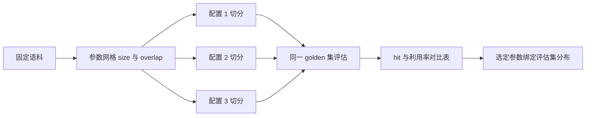

### Q1187 · chunk 大小实验框架

> 难度:★★★☆ | 标签:RAG, 实验

**问**:chunk 切多大最合适?拍脑袋行不行?怎么系统地做实验?

**答**:不行,chunk 大小与语料、问题分布强相关,必须实验。框架四件:参数化切分器(size、overlap、按句/段边界)、同一套假嵌入检索器、固定 golden 评估集(问题→应命中的来源文档)、指标计算(hit@k、上下文利用率=装入上下文的有用字符占比)。跑网格:size ∈ {200,400,800},overlap ∈ {0, 50},输出对比表。常见规律:chunk 太小召回准但上下文碎片化,太大上下文完整但稀释相似度、超窗。结论必须绑定评估集分布,换语料要重跑。

```python
# file: code/06_Agent与LLM及系统设计/q1187_chunk_experiment.py
"""chunk 大小实验框架:网格参数 + 假嵌入检索 + hit@k 与利用率对比。"""
import hashlib, math


def embed(text, dim=64):
    v = [0.0] * dim
    for tok in text.split():
        v[int(hashlib.md5(tok.encode()).hexdigest(), 16) % dim] += 1.0
    n = math.sqrt(sum(x * x for x in v)) or 1.0
    return [x / n for x in v]


def cosine(a, b):
    return sum(x * y for x, y in zip(a, b))


def chunk(doc, size, overlap):
    step = max(1, size - overlap)
    return [doc[i:i + size] for i in range(0, len(doc), step)]


class Retriever:
    def __init__(self, docs):
        self.chunks = [(c, embed(c)) for c in docs]

    def search(self, q, k=3):
        qv = embed(q)
        scored = sorted(self.chunks, key=lambda c: cosine(qv, c[1]), reverse=True)
        return [c for c, _ in scored[:k]]


def hit_at_k(retriever, golden, k=3):
    hits = sum(1 for q, must_contain in golden
               if any(must_contain in c for c in retriever.search(q, k)))
    return hits / len(golden)


if __name__ == "__main__":
    corpus = ("退货政策 7 天无理由 退货运费买家承担 。" * 8 +
              "发货政策 下单后 48 小时内发出 偏远地区除外 。" * 8 +
              "发票政策 支持电子发票 开票金额与实付一致 。" * 8)
    golden = [
        ("退货要运费吗", "退货运费买家承担"),
        ("多久能发货", "48 小时内发出"),
        ("发票金额怎么开", "与实付一致"),
    ]
    print(f"{'size':>6} {'overlap':>8} {'hit@3':>7} {'块数':>5}")
    best = None
    for size in (60, 120, 240):
        for overlap in (0, 20):
            chunks = chunk(corpus, size, overlap)
            r = Retriever(chunks)
            score = hit_at_k(r, golden)
            util = sum(len(c) for c in r.search("退货", 3)) / len(chunks[0]) / 3
            print(f"{size:>6} {overlap:>8} {score:>7.0%} {len(chunks):>5}")
            if best is None or score > best[0]:
                best = (score, size, overlap)
    print("最优参数:", best)
    assert best[0] >= 2 / 3, "最优配置至少命中 2/3"
```

**追问**:
- hit@k 不够怎么办?答:补充"答案质量"指标——把检索上下文交给 FakeLLM 生成并对照参考答案,评估端到端而非只看检索。
- 实验噪声怎么压?答:假嵌入确定性无噪声,真实模型有波动;固定随机种子、多次重复取均值、同一索引顺序,控制变量做到位。


